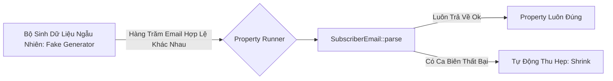

import { Callout } from "fumadocs-ui/components/callout";

Ở bài trước, chúng ta đã bảo vệ thành công trường `name` bằng kiểu dữ liệu `SubscriberName`. Giờ đây, bài test tích hợp của chúng ta đang dừng lại trước rào cản thứ hai: **kiểm tra tính hợp lệ của trường `email`**.

---

## I. Định Dạng Email: Cơn Ác Mộng Của Tiêu Chuẩn RFC

Tất cả chúng ta đều đã quá quen thuộc với cấu trúc trực quan của một địa chỉ email thông thường: `ten_nguoi_dung@ten_mien.com`. Thế nhưng, bài toán xác định thế nào là một địa chỉ email hợp lệ sẽ nhanh chóng trở thành một cơn ác mộng nếu bạn cố gắng bám sát các tiêu chuẩn kỹ thuật quốc tế.

Lực lượng Chuyên trách Kỹ thuật Internet (IETF) đã ban hành hàng loạt văn bản RFC (Request for Comments) mô tả cấu trúc chuẩn của địa chỉ email: [RFC 6854](https://tools.ietf.org/html/rfc6854), [RFC 5322](https://tools.ietf.org/html/rfc5322), [RFC 2822](https://tools.ietf.org/html/rfc2822). Nếu muốn tự viết một hàm `is_valid_email`, bạn sẽ phải đọc hàng trăm trang tài liệu này, tiêu hóa hàng loạt quy tắc cú pháp kỳ dị (như cho phép dấu ngoặc đơn chứa chú thích, dấu ngoặc kép bọc chuỗi, địa chỉ IP trong ngoặc vuông...). Độ phức tạp của nó rối rắm đến mức ngay cả [đặc tả chuẩn HTML của tổ chức WHATWG cũng cố tình *không tuân thủ* hoàn toàn các chuẩn RFC](https://html.spec.whatwg.org/multipage/input.html#valid-e-mail-address).

<Callout type="warn" title="Đừng Tự Viết Lại Bánh Xe Lãng Phí">
Trừ khi bạn thực sự quan tâm đến những sắc thái phức tạp của định dạng email, hãy cân nhắc dùng một thư viện có sẵn thay vì tự viết hàm `is_valid_email`. Trong hệ sinh thái Rust, crate [`validator`](https://crates.io/crates/validator) là một lựa chọn phù hợp; crate này tuân theo đặc tả HTML khi kiểm tra email.
</Callout>

---

## II. Xây Dựng Kiểu Dữ Liệu `SubscriberEmail`

Chúng ta sẽ áp dụng đúng triết lý Type-Driven Development đã dùng cho `SubscriberName`: mã hóa ràng buộc *"chuỗi này là một địa chỉ email hợp lệ"* vào một kiểu dữ liệu mới mang tên `SubscriberEmail`.

### 1. Phân Tách Sub-Module `domain`

Trước khi bắt tay vào viết mã, hãy dọn dẹp cấu trúc thư mục của dự án. File `src/domain.rs` bắt đầu phình to, vì vậy chúng ta sẽ phân tách nó thành các file nhỏ độc lập nằm trong thư mục `src/domain/`, tương tự như cách chúng ta đã phân tách `routes` ở Chương 3:

```text
src/
  routes/
    [...]
  domain/
    mod.rs
    subscriber_name.rs
    subscriber_email.rs
    new_subscriber.rs
  [...]
```

Nội dung file `src/domain/mod.rs` sẽ chịu trách nhiệm re-export các kiểu dữ liệu công khai:

```rust
//! src/domain/mod.rs

mod new_subscriber;
mod subscriber_email;
mod subscriber_name;

pub use new_subscriber::NewSubscriber;
pub use subscriber_email::SubscriberEmail;
pub use subscriber_name::SubscriberName;
```

Mỗi struct và toàn bộ unit test đi kèm sẽ nằm trọn vẹn trong file tương ứng của nó. Nhờ các lệnh `pub use`, giao diện lập trình (public API) của module `domain` không hề thay đổi, đảm bảo các phần khác của hệ thống không bị xáo trộn.

---

### 2. Khung Xương Kiểu `SubscriberEmail`

Chúng ta tạo file `src/domain/subscriber_email.rs` với khung xương ban đầu:

```rust
//! src/domain/subscriber_email.rs

#[derive(Debug)]
pub struct SubscriberEmail(String);

impl SubscriberEmail {
    pub fn parse(s: String) -> Result<SubscriberEmail, String> {
        // Tạm thời cho qua mọi chuỗi để kiểm chứng test
        Ok(Self(s))
    }
}

impl AsRef<str> for SubscriberEmail {
    fn as_ref(&self) -> &str {
        &self.0
    }
}
```

Theo đúng quy trình TDD (Test-Driven Development), chúng ta viết ngay các ca kiểm thử cho những trường hợp email không hợp lệ:

```rust
//! src/domain/subscriber_email.rs
// [...]

#[cfg(test)]
mod tests {
    use super::SubscriberEmail;
    use claims::assert_err;

    #[test]
    fn empty_string_is_rejected() {
        let email = "".to_string();
        assert_err!(SubscriberEmail::parse(email));
    }

    #[test]
    fn email_missing_at_symbol_is_rejected() {
        let email = "ursuladomain.com".to_string();
        assert_err!(SubscriberEmail::parse(email));
    }

    #[test]
    fn email_missing_subject_is_rejected() {
        let email = "@domain.com".to_string();
        assert_err!(SubscriberEmail::parse(email));
    }
}
```

Chạy `cargo test domain`, cả 3 bài test đều thất bại (đúng như mong đợi). Bây giờ chúng ta đưa crate `validator` vào dự án:

```toml
# Cargo.toml
# [...]
[dependencies]
validator = "0.16"
# [...]
```

Và cập nhật hàm `parse` để ủy thác toàn bộ logic kiểm tra cho hàm `validator::validate_email`:

```rust
//! src/domain/subscriber_email.rs
use validator::validate_email;

#[derive(Debug)]
pub struct SubscriberEmail(String);

impl SubscriberEmail {
    pub fn parse(s: String) -> Result<SubscriberEmail, String> {
        if validate_email(&s) {
            Ok(Self(s))
        } else {
            Err(format!("{} is not a valid subscriber email.", s))
        }
    }
}
// [...]
```

Chạy lại test: cả 3 unit test cho email lỗi đều lập tức **chuyển sang màu xanh (pass)**!

---

## III. Property-Based Testing (Kiểm Thử Hướng Thuộc Tính)

Nhìn lại các unit test ở trên, bạn sẽ nhận ra một điểm yếu cố hữu: tất cả các bài test đều kiểm tra các trường hợp **email không hợp lệ**. Chúng ta bắt buộc phải có ít nhất một bài test xác nhận rằng các **email hợp lệ thực sự được chấp nhận**!

Nếu chúng ta hard-code một địa chỉ email cụ thể vào bài test (ví dụ: `ursula@domain.com`):
```rust
#[test]
fn a_valid_email_is_parsed_successfully() {
    let email = "ursula@domain.com".to_string();
    claims::assert_ok!(SubscriberEmail::parse(email));
}
```
Bài test này mang lại giá trị gì? Nó chỉ đơn thuần chứng minh rằng duy nhất địa chỉ `"ursula@domain.com"` là hợp lệ, hoàn toàn không mang lại cho chúng ta sự tự tin rằng hệ thống hoạt động đúng trên toàn bộ không gian dữ liệu email thực tế.

Đây là lúc phương pháp **Property-Based Testing (Kiểm thử hướng thuộc tính)** phát huy sức mạnh tối thượng.



Thay vì kiểm tra một vài giá trị cố định, chúng ta khẳng định một **thuộc tính tổng quát (property)** của hệ thống: *"Không email hợp lệ nào bị hàm parse từ chối"*. Property-based testing mở rộng đáng kể phạm vi đầu vào được kiểm tra và tăng độ tin cậy, nhưng không chứng minh parser đúng vì không khảo sát toàn bộ không gian đầu vào (trừ những không gian rất nhỏ).

---

### 1. Sinh Dữ Liệu Ngẫu Nhiên Với Crate `fake`

Để sinh dữ liệu email ngẫu nhiên nhưng đảm bảo đúng quy chuẩn, chúng ta bổ sung crate [`fake`](https://crates.io/crates/fake) vào `dev-dependencies`:

```toml
# Cargo.toml
# [...]
[dev-dependencies]
# Không dùng fake >= 2.4 ở thời điểm sách viết: phiên bản đó dùng rand 0.8,
# chưa tương thích với quickcheck (vấn đề dự kiến được giải quyết ở quickcheck 1.0).
fake = "~2.3"
```

Crate `fake` cung cấp sẵn faker `SafeEmail` để tạo địa chỉ email chuẩn:

```rust
use fake::faker::internet::en::SafeEmail;
use fake::Fake;

#[test]
fn valid_emails_are_parsed_successfully() {
    let email = SafeEmail().fake();
    claims::assert_ok!(SubscriberEmail::parse(email));
}
```

Mỗi lần chạy `cargo test`, `SafeEmail().fake()` sẽ sinh ra một địa chỉ email ngẫu nhiên mới. Đây đã là một bước tiến vượt bậc. Tuy nhiên, nếu chỉ chạy 1 lần mỗi lần gõ lệnh test thì vẫn có thể bỏ sót những trường hợp biên (edge cases). Chúng ta cần một framework chuyên nghiệp cho Property-Based Testing!

---

### 2. Lựa Chọn Framework: `quickcheck` vs `proptest`

Trong hệ sinh thái Rust có hai lựa chọn phổ biến cho Property-based Testing là [`quickcheck`](https://crates.io/crates/quickcheck) và [`proptest`](https://crates.io/crates/proptest). Phạm vi sử dụng của chúng có phần giao nhau, nhưng mỗi crate có thế mạnh riêng; có thể xem README của từng crate để biết chi tiết.

Trong dự án này, chúng ta chọn **`quickcheck`** vì tương đối dễ bắt đầu và không dùng quá nhiều macro, giúp trải nghiệm IDE dễ chịu hơn:

```toml
# Cargo.toml
# [...]
[dev-dependencies]
quickcheck = "0.9.2"
quickcheck_macros = "0.9.1"
```

Cơ chế của `quickcheck`:
1. Hàm test được đánh dấu bằng thuộc tính `#[quickcheck_macros::quickcheck]`.
2. Framework sẽ tự động chạy hàm test đó lặp đi lặp lại 100 lần (mặc định), mỗi lần truyền vào một giá trị ngẫu nhiên mới.
3. Nếu hàm test trả về `false` (thất bại), `quickcheck` sẽ tự động thực hiện thao tác **thu hẹp (shrinking)** để tìm ra ca biên nhỏ nhất và đơn giản nhất gây ra lỗi, giúp lập trình viên khoanh vùng sự cố ngay lập tức.

---

### 3. Cài Đặt Trait `Arbitrary` & Khả Năng Tương Thích Hoàn Hảo

Làm thế nào để `quickcheck` biết cách sinh ra một địa chỉ email hợp lệ thay vì sinh ra một chuỗi ký tự rác ngẫu nhiên? Câu trả lời nằm ở trait **[`Arbitrary`](https://docs.rs/quickcheck/0.9.2/quickcheck/trait.Arbitrary.html)**:

```rust
pub trait Arbitrary: Clone + Send + 'static {
    fn arbitrary<G: Gen>(g: &mut G) -> Self;
    fn shrink(&self) -> Box<dyn Iterator<Item = Self>> {
        empty_shrinker()
    }
}
```

Chúng ta định nghĩa một struct bọc dữ liệu phục vụ test mang tên `ValidEmailFixture`. Vì `Arbitrary` có triển khai mặc định cho `shrink` dùng `empty_shrinker`, fixture này chỉ cần tự cài đặt `arbitrary`; khi gặp lỗi, `quickcheck` sẽ không thu nhỏ fixture để tìm ví dụ lỗi đơn giản hơn:

```rust
//! src/domain/subscriber_email.rs
// [...]

#[cfg(test)]
mod tests {
    use super::SubscriberEmail;
    use claims::assert_err;
    use fake::faker::internet::en::SafeEmail;
    use fake::Fake;

    #[derive(Debug, Clone)]
    struct ValidEmailFixture(pub String);

    impl quickcheck::Arbitrary for ValidEmailFixture {
        fn arbitrary<G: quickcheck::Gen>(g: &mut G) -> Self {
            let email = SafeEmail().fake_with_rng(g);
            Self(email)
        }
    }

    #[quickcheck_macros::quickcheck]
    fn valid_emails_are_parsed_successfully(valid_email: ValidEmailFixture) -> bool {
        SubscriberEmail::parse(valid_email.0).is_ok()
    }
}
```

<Callout type="info" title="Vẻ Đẹp Kiến Trúc Của Hệ Thống Trait Trong Rust">
Hãy chú ý cách `fake` và `quickcheck` bắt tay với nhau một cách diệu kỳ:
- Tham số `g` trong phương thức `Arbitrary::arbitrary` implement trait `quickcheck::Gen`, mà `Gen` lại kế thừa từ `RngCore` trong crate `rand-core`.
- Phương thức `fake_with_rng` của crate `fake` chấp nhận bất kỳ kiểu dữ liệu nào implement trait `Rng` của crate `rand`.
- Nhờ việc toàn bộ cộng đồng Rust cùng thống nhất trên bộ trait lõi của `rand`, hai thư viện hoàn toàn độc lập này có thể truyền đối tượng sinh số ngẫu nhiên qua lại cho nhau mà **không cần biết gì về nhau**!
</Callout>

Chạy `cargo test domain`: `quickcheck` mặc định thử thuộc tính 100 lần, mỗi lần dùng một email được sinh qua `SafeEmail` và kiểm tra parser không từ chối. Nếu muốn xem dữ liệu ngẫu nhiên được tạo ra, thêm `dbg!(&valid_email.0);` vào test rồi chạy `cargo test valid_emails -- --nocapture`; terminal sẽ in ra nhiều email hợp lệ.

---

## IV. Tích Hợp Payload Validation & Tái Cấu Trúc Với `TryFrom`

Bây giờ, chúng ta tích hợp `SubscriberEmail` vào toàn bộ ứng dụng:

```rust
//! src/domain/new_subscriber.rs
use crate::domain::SubscriberEmail;
use crate::domain::SubscriberName;

pub struct NewSubscriber {
    // Không còn dùng String thô nữa!
    pub email: SubscriberEmail,
    pub name: SubscriberName,
}
```

Cập nhật hàm `insert_subscriber` trong `src/routes/subscriptions.rs` để gọi `.as_ref()` trên cả hai trường:

```rust
//! src/routes/subscriptions.rs
// [...]

#[tracing::instrument([...])]
pub async fn insert_subscriber(
    pool: &PgPool,
    new_subscriber: &NewSubscriber,
) -> Result<(), sqlx::Error> {
    sqlx::query!(
        r#"
    INSERT INTO subscriptions (id, email, name, subscribed_at)
    VALUES ($1, $2, $3, $4)
        "#,
        Uuid::new_v4(),
        new_subscriber.email.as_ref(),
        new_subscriber.name.as_ref(),
        Utc::now()
    )
    .execute(pool)
    .await
    .map_err(|e| {
        tracing::error!("Failed to execute query: {:?}", e);
        e
    })?;
    Ok(())
}
```

### Chuẩn Hóa Chuyển Đổi Dữ Liệu Bằng Trait `TryFrom` và `TryInto`

Trong request handler `subscribe`, việc phân tích cú pháp từ dữ liệu thô của form (`FormData`) sang domain model (`NewSubscriber`) thực chất là một phép **chuyển đổi kiểu dữ liệu có thể thất bại**. Ta có thể tách riêng logic này thành hàm `parse_subscriber`, trả về `Result<NewSubscriber, String>`, để phân biệt việc chuyển đổi wire format thành domain model với việc tạo HTTP response.

Thư viện chuẩn Rust có trait **[`TryFrom`](https://doc.rust-lang.org/std/convert/trait.TryFrom.html)** dành cho kiểu chuyển đổi có thể thất bại và tiêu thụ giá trị đầu vào. Chữ ký của trait này tương ứng với hàm `parse_subscriber`:

```rust
//! src/routes/subscriptions.rs
// Lưu ý: Trait TryFrom và TryInto đã nằm sẵn trong Rust Prelude từ Edition 2021
// [...]

impl TryFrom<FormData> for NewSubscriber {
    type Error = String;

    fn try_from(value: FormData) -> Result<Self, Self::Error> {
        let name = SubscriberName::parse(value.name)?;
        let email = SubscriberEmail::parse(value.email)?;
        Ok(Self { email, name })
    }
}

#[tracing::instrument(
    name = "Adding a new subscriber",
    skip(form, pool),
    fields(
        subscriber_email = %form.email,
        subscriber_name = %form.name
    )
)]
pub async fn subscribe(
    form: web::Form<FormData>,
    pool: web::Data<PgPool>,
) -> HttpResponse {
    // Gọi .try_into() trực tiếp trên dữ liệu form!
    let new_subscriber = match form.0.try_into() {
        Ok(subscriber) => subscriber,
        Err(_) => return HttpResponse::BadRequest().finish(),
    };
    match insert_subscriber(&pool, &new_subscriber).await {
        Ok(_) => HttpResponse::Ok().finish(),
        Err(_) => HttpResponse::InternalServerError().finish(),
    }
}
```

<Callout type="info" title="Tại Sao Nên Cài Đặt TryFrom Thay Vì Hàm Riêng?">
1. Khi bạn implement `TryFrom<T> for U`, Rust sẽ **tự động implement miễn phí** trait đối ứng `TryInto<U> for T`. Nhờ đó bạn có thể gọi phương thức chuỗi `form.0.try_into()` cực kỳ thanh lịch.
2. Nó biểu đạt ý đồ thiết kế rõ ràng: bất kỳ lập trình viên Rust nào khi đọc mã nguồn cũng lập tức nhận ra đây là một thao tác chuyển đổi kiểu dữ liệu tiêu chuẩn từ Wire Format (HTTP payload) sang Domain Model.
</Callout>

Bây giờ, hãy chạy lại toàn bộ bộ integration test:

```text
running 4 tests
test subscribe_returns_a_400_when_data_is_missing ... ok
test health_check_works ... ok
test subscribe_returns_a_400_when_fields_are_present_but_invalid ... ok
test subscribe_returns_a_200_for_valid_form_data ... ok

test result: ok. 4 passed; 0 failed; 0 ignored; 0 measured; 0 filtered out
```

**Tất cả 4 bài test tích hợp đều đã xanh mướt!**

---

## V. Tổng Kết Chương 6

Chúng ta đã hoàn thành xuất sắc mục tiêu của Chương 6:
- Loại bỏ hoàn toàn lỗ hổng tiếp nhận dữ liệu dễ dãi của endpoint `POST /subscriptions`.
- Thấu hiểu và áp dụng triệt để triết lý **Type-Driven Development** kết hợp **Newtype Pattern** (`SubscriberName`, `SubscriberEmail`), biến các trạng thái không hợp lệ thành không thể biểu diễn được.
- Bảo vệ invariants bằng Ownership và chuyển đổi tham chiếu chỉ đọc qua trait `AsRef<str>`.
- Xử lý lỗi chuẩn mực với `Result`, loại bỏ `panic!` và trả về HTTP 400 Bad Request.
- Nâng tầm chất lượng kiểm thử với `claims` và **Property-based Testing** (`fake` + `quickcheck`).
- Chuẩn hóa ranh giới chuyển đổi dữ liệu bằng `TryFrom` / `TryInto`.

Việc kiểm tra email thỏa mãn định dạng cú pháp vẫn chưa đủ: ta chưa biết địa chỉ đó có tồn tại hay có thể nhận thư hay không. Cách duy nhất để biết là gửi email thực tế. Đây là chủ đề của chương tiếp theo.
