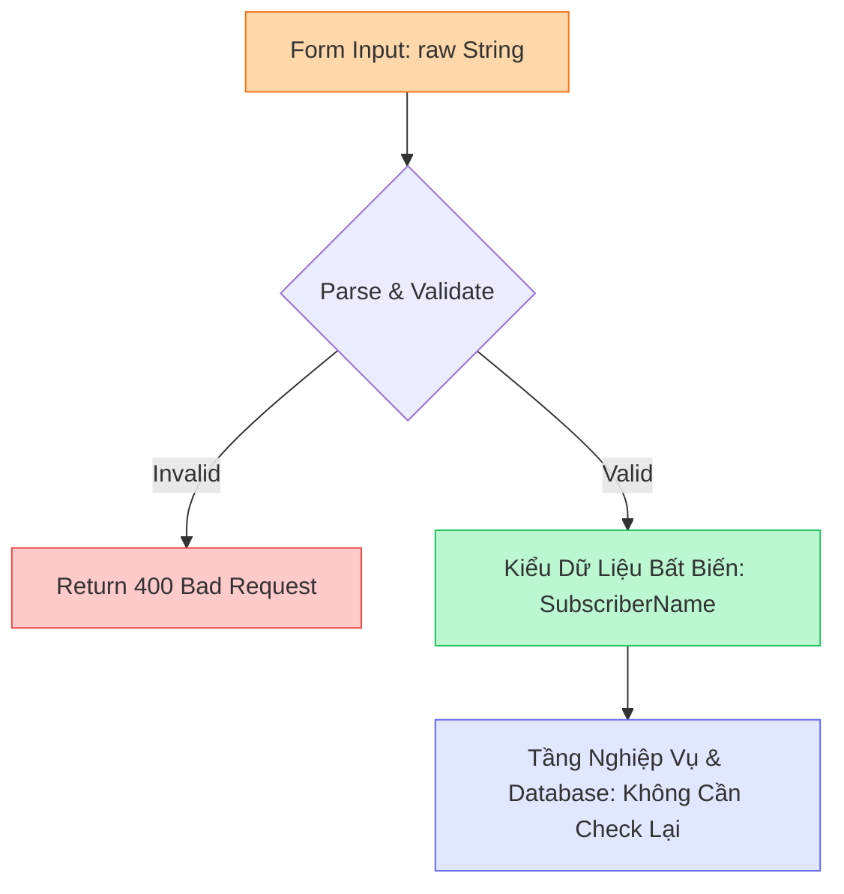

import { Callout } from "fumadocs-ui/components/callout";

# Tổng Quan Chương 6: Reject Invalid Subscribers #1

API newsletter của chúng ta đã chính thức đi vào hoạt động (live) trên nền tảng Cloud. Chúng ta đã trang bị hệ thống đo kiểm viễn trắc (telemetry & tracing) bài bản để kịp thời phát hiện mọi sự cố phát sinh trong quá trình vận hành, đồng thời cung cấp endpoint công khai `POST /subscriptions` để tiếp nhận độc giả đăng ký nhận tin.

Chúng ta đã đi được một chặng đường rất dài!

Thế nhưng, trên hành trình đó, chúng ta đã tạm chấp nhận một vài thỏa hiệp kỹ thuật (cut corners): endpoint `POST /subscriptions` hiện tại đang quá… dễ dãi. Cơ chế kiểm tra tính hợp lệ của dữ liệu đầu vào (input validation) vô cùng sơ sài — chúng ta mới chỉ kiểm tra xem trường `name` và `email` có tồn tại trong payload hay không, ngoài ra không hề có thêm bất kỳ ràng buộc nào khác.

<Callout type="warn" title="Lỗ Hổng Tiếp Nhận Dữ Liệu Dễ Dãi">
Hiện tại, nếu người dùng gửi một chuỗi rỗng (`name=""`), email sai định dạng (`email="definitely-not-an-email"`), hoặc chuỗi chứa ký tự điều khiển nguy hiểm, API vẫn vui vẻ trả về `200 OK` và lưu thẳng vào cơ sở dữ liệu PostgreSQL. Khi hệ thống tiến hành gửi email hàng loạt ở các chương sau, những dữ liệu rác này chắc chắn sẽ gây ra thảm họa!
</Callout>

---

## I. Thách Thức Nghiệp Vụ & Giới Hạn Của Validation Truyền Thống

Trong chương này, chúng ta sẽ bắt đầu giải quyết bài toán kiểm tra tính hợp lệ của dữ liệu đăng ký — khởi đầu với trường `name`.

1. **Yêu cầu nghiệp vụ (Domain Constraints)**: Tên người dùng là một miền dữ liệu vô cùng phức tạp (độc giả có thể tham khảo bài viết kinh điển *"Falsehoods programmers believe about names"*). Mục đích chúng ta thu thập tên chỉ để cá nhân hóa lời chào mở đầu trong email, do đó ta không áp đặt các quy chuẩn hà khắc, mà chỉ yêu cầu tên không được rỗng (chứa ít nhất một ký tự không phải khoảng trắng).
2. **Yêu cầu bảo mật (Security Constraints & Defense in Depth)**: Khi newsletter phát triển, ứng dụng sẽ thu hút kẻ tấn công. Chúng ta cần phòng chống tấn công từ chối dịch vụ (DoS), tiêm nhiễm mã độc (SQL injection, XSS) và phishing bằng cách:
   - Giới hạn độ dài tối đa (256 ký tự grapheme Unicode mở rộng).
   - Từ chối các ký tự nguy hiểm thường xuất hiện trong câu lệnh SQL và HTML: `['/', '(', ')', '"', '<', '>', '\\', '{', '}']`.
3. **Hiện tượng "Nồi súp rỉ nước" (Validation Is A Leaky Cauldron)**: Viết một hàm kiểm tra đơn thuần `is_valid_name(&str) -> bool` ở tầng controller chỉ mang lại ảo tưởng về sự an toàn. Khi một hàm nghiệp vụ bên dưới (như `insert_subscriber`) tiếp nhận tham số `String`, nó không thể tin tưởng liệu chuỗi đó đã được validate hay chưa nếu chỉ nhìn vào kiểu dữ liệu. Thông tin xác thực đã bị đánh mất ngay sau khi hàm kiểm tra chạy xong!

---

## II. Triết Lý Cốt Lõi: Type-Driven Development

Thay vì chỉ kiểm tra điều kiện tại một thời điểm rồi vứt bỏ kết quả, chúng ta áp dụng triết lý kinh điển của Alexis King: **"Parse, don't validate"** thông qua **Type-Driven Development (Phát triển hướng kiểu dữ liệu)**.

- **Newtype Pattern**: Đóng gói chuỗi nguyên thủy `String` vào một tuple struct riêng biệt `SubscriberName(String)` với trường nội bộ ở trạng thái `private`.
- **Hàm khởi tạo duy nhất (`SubscriberName::parse`)**: Cách duy nhất để tạo ra một instance của `SubscriberName` từ bên ngoài module `domain` là đi qua hàm `parse`. Nếu dữ liệu vi phạm bất kỳ ràng buộc nào, việc khởi tạo sẽ thất bại.
- **Bảo toàn Invariants**: Một khi bạn nắm trong tay một giá trị kiểu `SubscriberName`, trình biên dịch Rust đảm bảo 100% về mặt cấu trúc rằng mọi quy tắc nghiệp vụ (**invariants**) đều được thỏa mãn. Bất kỳ đoạn code nào nhận tham số kiểu `SubscriberName` đều có thể tin tưởng tuyệt đối mà không cần viết thêm một dòng code kiểm tra trùng lặp nào.

---

## III. Các Chủ Đề Trọng Tâm Trong Chương 6

Chương này được chia thành 4 bài học chi tiết, dẫn dắt từ nền tảng lý thuyết đến các kỹ thuật Rust nâng cao:

| Bài học | Nội dung chính |
| :--- | :--- |
| **[6.1 Yêu Cầu Nghiệp Vụ & Lỗ Hổng Validation](./01-yeu-cau-nghiep-vu-va-lo-hong-validation)** | Phân tích Domain & Security constraints, hiện thực hàm `is_valid_name` ban đầu và mổ xẻ bài học kiến trúc "Validation Is A Leaky Cauldron". |
| **[6.2 Type-Driven Development & Invariants](./02-type-driven-development-va-invariants)** | Xây dựng kiểu dữ liệu `SubscriberName`, bảo vệ invariants bằng Ownership, chuyển đổi an toàn qua trait `AsRef<str>` và phân tích tác hại của `panic!` trong production. |
| **[6.3 Xử Lý Result & Claims Assertions](./03-xu-ly-result-va-claims-assertions)** | Biểu diễn lỗi như giá trị (`Result<T, E>`), viết test rõ ràng với crate `claims`, xử lý lỗi bằng `match` và toán tử `?`, ánh xạ phản hồi HTTP 400 Bad Request. |
| **[6.4 SubscriberEmail & Property-Based Testing](./04-subscriber-email-va-property-based-testing)** | Quy chuẩn email RFC, tách module `domain`, kiểm thử sinh dữ liệu ngẫu nhiên với `fake` & `quickcheck` (`Arbitrary` trait), tái cấu trúc payload validation bằng `TryFrom`/`TryInto`. |

---

## IV. Mục Tiêu Đạt Được Sau Chương Này

Sau khi hoàn thành chương 6, bạn sẽ làm chủ:
- Tư duy thiết kế hệ thống kiểu dữ liệu để biến các trạng thái không hợp lệ thành **không thể biểu diễn được** (make illegal states unrepresentable).
- Kỹ thuật kết hợp Ownership và Borrowing của Rust để chia sẻ dữ liệu đọc an toàn (`AsRef`) mà không làm suy yếu tính bất biến của domain model.
- Cách tiếp cận kiểm thử nâng cao với **Property-based Testing**, giúp phát hiện những ca biên (edge cases) hiểm hóc mà unit test thủ công dễ dàng bỏ sót.
- Chuẩn hóa quy trình chuyển đổi dữ liệu từ tầng HTTP transport sang Domain entity bằng các chuẩn trait của thư viện chuẩn Rust (`TryFrom` / `TryInto`).
