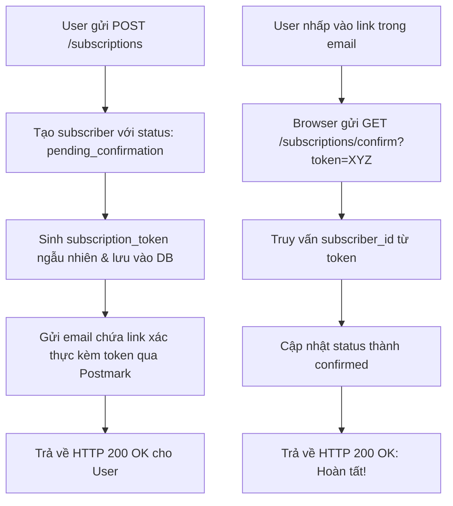

import { Callout } from "fumadocs-ui/components/callout";

Ở Chương 6, chúng ta đã trang bị cho hệ thống khả năng kiểm tra định dạng email và tên người dùng bằng Type-Driven Development. Giờ đây chúng ta có những địa chỉ email hợp lệ về mặt cú pháp (`syntactically valid`), nhưng ta hoàn toàn không biết liệu hòm thư đó có thực sự tồn tại hay không và người dùng có thực sự muốn nhận tin hay không.

Cách duy nhất để giải quyết triệt để vấn đề này là gửi một **email xác thực (confirmation email)** thực tế đến hòm thư của họ.

---

## I. Email Xác Thực & Sự Đồng Thuận Của Subscriber

Bản năng lập trình của bạn có thể đang đặt câu hỏi: *Liệu chúng ta có thực sự cần biết email có tồn tại ngay tại thời điểm đăng ký này không? Tại sao không cứ lưu vào database rồi đợi đến lần phát hành bản tin newsletter tiếp theo để kiểm tra xem họ có nhận được thư hay không?*

Nếu mục tiêu duy nhất của chúng ta chỉ là kiểm tra tính hợp lệ của dữ liệu, việc trì hoãn đến lúc gửi bản tin có vẻ hợp lý để tránh làm phức tạp hóa endpoint `POST /subscriptions`. Tuy nhiên, có một yếu tố cốt tử khác mà chúng ta **tuyệt đối không thể trì hoãn**: **sự đồng thuận của độc giả (Subscriber Consent)**.

Địa chỉ email không phải là mật khẩu bí mật. Nếu bạn tham gia Internet đủ lâu, địa chỉ email của bạn rất dễ bị lộ. Nhiều loại email (như email công việc) thậm chí còn được công khai trên các trang web và mạng xã hội.

Điều này mở ra nguy cơ bị **lạm dụng (abuse)** nghiêm trọng:
- Một kẻ phá hoại có thể dùng một địa chỉ email của nạn nhân đem đi đăng ký hàng trăm dịch vụ newsletter trên khắp Internet, khiến hòm thư của nạn nhân bị ngập chìm trong thư rác (email bomb).
- Một chủ trang web newsletter bất lương có thể dùng bot cào hàng nghìn địa chỉ email trên mạng và tự ý thêm vào danh sách gửi tin để quảng cáo spam.

<Callout type="warn" title="Ràng Buộc Pháp Lý & Tiêu Chuẩn GDPR">
Một request gửi đến `POST /subscriptions` hoàn toàn **không đủ bằng chứng** để khẳng định: *"Chủ nhân của hòm thư này đồng ý nhận nội dung của tôi!"*. Đặc biệt nếu bạn phục vụ người dùng tại thị trường Châu Âu, việc thu thập sự đồng thuận rõ ràng (explicit consent) là một **yêu cầu bắt buộc về mặt pháp lý** theo luật Bảo vệ Dữ liệu Chung (GDPR).
</Callout>

Đó là lý do mô hình **Double Opt-In** (Xác thực 2 bước) trở thành chuẩn mực công nghiệp toàn cầu: Sau khi người dùng điền biểu mẫu, hệ thống sẽ gửi một email xác thực. Chỉ khi họ nhấp vào liên kết trong email thì quá trình đăng ký mới chính thức hoàn tất.

---

## II. Hành Trình Trải Nghiệm Của Người Dùng (Confirmation User Journey)

Hãy nhìn luồng xác thực dưới góc nhìn của một độc giả:
1. Độc giả nhận được một email chứa **liên kết xác thực duy nhất (confirmation link)**.
2. Khi độc giả nhấp vào liên kết, trình duyệt mở ra và một thông báo chào mừng xuất hiện (*"Bạn đã trở thành độc giả chính thức của bản tin!"*). Kể từ giây phút đó, họ sẽ nhận được các số newsletter tiếp theo.

Ở phía backend, chúng ta sẽ thiết kế một luồng xử lý tinh gọn nhưng an toàn:



Chiến lược triển khai của chúng ta sẽ được chia thành 3 phần rõ rệt:
1. Xây dựng module gửi email (`EmailClient`) độc lập.
2. Điều chỉnh logic của endpoint `POST /subscriptions` để tích hợp việc gửi email và lưu token.
3. Xây dựng endpoint `GET /subscriptions/confirm` từ đầu.

---

## III. Xây Dựng `EmailClient` Bằng `reqwest`

Làm thế nào để một ứng dụng thực sự gửi được một email ra thế giới bên ngoài?

Giao thức nền tảng của email là **SMTP (Simple Mail Transfer Protocol)** ra đời từ năm 1982 (RFC 821). SMTP đối với email cũng tương tự như HTTP đối với các trang web. Tuy nhiên, việc tự dựng và vận hành một máy chủ SMTP riêng là một gánh nặng khổng lồ (quản lý IP reputation, chống spam, cấu hình DKIM/SPF/DMARC...).

Hầu hết các nhà cung cấp dịch vụ gửi email chuyên nghiệp ngày nay đều cung cấp hai cổng giao tiếp: **SMTP** và **REST API**. Đối với lập trình viên ứng dụng hiện đại, giao tiếp qua **REST API** tiện lợi, ổn định và dễ kiểm soát lỗi hơn rất nhiều.

### 1. Lựa Chọn Nhà Cung Cấp Email API

Trên thị trường có rất nhiều tên tuổi lớn như AWS SES, SendGrid, Mailgun, Mailchimp và Postmark. Chúng ta lựa chọn **[Postmark](https://postmarkapp.com)** vì API cực kỳ trực quan, tài liệu xuất sắc, và gói miễn phí của họ cho phép thử nghiệm ngay mà không đòi hỏi phải nhập thông tin thẻ tín dụng.

Để chuẩn bị, bạn cần tạo một tài khoản Postmark và xác thực một địa chỉ email người gửi (single sender):


---

### 2. Thiết Kế Giao Diện `EmailClient` (Interface First)

Thay vì đâm đầu vào code chi tiết, chúng ta áp dụng tư duy thiết kế từ trên xuống (Top-down): định hình chữ ký giao tiếp mong muốn trước:

```rust
//! src/email_client.rs
use crate::domain::SubscriberEmail;

pub struct EmailClient {
    sender: SubscriberEmail
}

impl EmailClient {
    pub async fn send_email(
        &self, 
        recipient: SubscriberEmail, 
        subject: &str, 
        html_content: &str,
        text_content: &str
    ) -> Result<(), String> {
        todo!()
    }
}
```

<Callout type="info" title="Tại Sao Lại Cần Cả Nội Dung HTML Lẫn Plain Text?">
Một số ứng dụng đọc email cổ điển hoặc trên thiết bị đầu cuối không hỗ trợ render HTML. Ngoài ra, một số người dùng có thói quen tắt chế độ hiển thị HTML vì lý do bảo mật. Gửi kèm cả phiên bản Plain Text là một thực hành kỹ thuật chuyên nghiệp, đảm bảo thông điệp luôn được truyền tải trọn vẹn đến 100% độc giả.
</Callout>

Khai báo module mới trong `src/lib.rs`:

```rust
//! src/lib.rs
pub mod configuration;
pub mod domain;
pub mod email_client; // Module mới!
pub mod routes;
pub mod startup;
pub mod telemetry;
```

---

### 3. Hiện Thực REST Client Bằng `reqwest`

Trong hệ sinh thái Rust, [`reqwest`](https://crates.io/crates/reqwest) là thư viện HTTP Client phổ biến và được kiểm chứng qua thực tế nhiều nhất. Chúng ta đưa `reqwest` từ `dev-dependencies` lên `dependencies` trong `Cargo.toml`:

```toml
# Cargo.toml
# [...]
[dependencies.reqwest]
version = "0.11" 
default-features = false
# Kích hoạt json và dùng rustls để độc lập với thư viện C của hệ điều hành
features = ["json", "rustls-tls"]
```

#### Connection Pooling (Tái Sử Dụng Kết Nối)
Mỗi lần thiết lập kết nối HTTP (đặc biệt là HTTPS) đều tốn kém tài nguyên: bắt tay TCP 3 bước (TCP handshake), bắt tay mã hóa TLS, đàm phán chứng chỉ... Nếu mỗi lần gửi email chúng ta lại tạo một kết nối mới, hiệu năng ứng dụng sẽ sụt giảm nghiêm trọng.

Rất may mắn, bên dưới lớp vỏ của `reqwest::Client` đã tích hợp sẵn một **Connection Pool**. Việc clone một `reqwest::Client` thực chất chỉ là clone một con trỏ `Arc` tham chiếu đến pool kết nối nội bộ!

```rust
//! src/email_client.rs
use crate::domain::SubscriberEmail;
use reqwest::Client;

pub struct EmailClient {
    http_client: Client,
    base_url: String,
    sender: SubscriberEmail,
    authorization_token: String,
}

impl EmailClient {
    pub fn new(
        base_url: String, 
        sender: SubscriberEmail,
        authorization_token: String,
    ) -> Self {
        Self {
            http_client: Client::new(),
            base_url,
            sender,
            authorization_token,
        }
    }
}
```

#### Tái Sử Dụng Trong Actix-Web
Để chia sẻ `EmailClient` cho các Actix worker threads mà không cấp phát lại bộ nhớ cho các trường chuỗi (`base_url`, `authorization_token`), chúng ta bọc `EmailClient` vào `actix_web::web::Data` (con trỏ `Arc` luồng an toàn), tương tự như cách chúng ta đã làm với `PgPool`:

```rust
//! src/startup.rs
use crate::email_client::EmailClient;
use actix_web::web::Data;

pub fn run(
    listener: TcpListener,
    db_pool: PgPool,
    email_client: EmailClient,
) -> Result<Server, std::io::Error> {
    let db_pool = Data::new(db_pool);
    let email_client = Data::new(email_client);
    let server = HttpServer::new(move || {
        App::new()
            .wrap(TracingLogger::default())
            .route("/health_check", web::get().to(health_check))
            .route("/subscriptions", web::post().to(subscribe))
            .app_data(db_pool.clone())
            .app_data(email_client.clone())
    })
    .listen(listener)?
    .run();
    Ok(server)
}
```

---

## IV. Kiểm Thử HTTP Client Độc Lập Với `wiremock`

Làm thế nào để kiểm thử phương thức `send_email` mà không phải gửi hàng nghìn email rác thật đến Postmark làm cạn kiệt hạn ngạch tài khoản?

Chúng ta cần một **Mock Server** chạy trên localhost để đánh chặn (intercept) các request HTTP đi ra. Crate [`wiremock`](https://github.com/lukemathwalker/wiremock-rs) của Luke Mathwalker là giải pháp tiêu chuẩn vàng trong hệ sinh thái Rust.

```toml
# Cargo.toml
# [...]
[dev-dependencies]
wiremock = "0.5"
tokio = { version = "1", features = ["rt", "macros"] }
```

Hãy xem bài test đầu tiên kiểm tra xem `send_email` có thực sự bắn request HTTP tới đúng URL mong đợi hay không:

```rust
//! src/email_client.rs
// [...]

#[cfg(test)]
mod tests {
    use crate::domain::SubscriberEmail;
    use crate::email_client::EmailClient;
    use fake::faker::internet::en::SafeEmail;
    use fake::faker::lorem::en::{Paragraph, Sentence};
    use fake::{Fake, Faker};
    use wiremock::matchers::any;
    use wiremock::{Mock, MockServer, ResponseTemplate};

    #[tokio::test]
    async fn send_email_fires_a_request_to_base_url() {
        // Arrange: Khởi động MockServer ngẫu nhiên trên cổng trống
        let mock_server = MockServer::start().await;
        let sender = SubscriberEmail::parse(SafeEmail().fake()).unwrap();
        let email_client = EmailClient::new(
            mock_server.uri(), 
            sender, 
            Faker.fake(),
            std::time::Duration::from_millis(200),
        );

        // Thiết lập kỳ vọng: Mọi request gửi tới mock_server phải nhận được phản hồi 200 OK
        // và kỳ vọng có chính xác 1 request được kích hoạt (.expect(1))
        Mock::given(any())
            .respond_with(ResponseTemplate::new(200))
            .expect(1)
            .mount(&mock_server)
            .await;

        let subscriber_email = SubscriberEmail::parse(SafeEmail().fake()).unwrap();
        let subject: String = Sentence(1..2).fake();
        let content: String = Paragraph(1..10).fake();

        // Act: Thực hiện gửi email
        let _ = email_client
            .send_email(&subscriber_email, &subject, &content, &content)
            .await;

        // Assert: MockServer tự động xác nhận số lượng request khi đối tượng bị drop!
    }
}
```

<Callout type="info" title="Sức Mạnh Của wiremock::Mock::expect">
Phương thức `.expect(1)` đảm bảo rằng nếu hàm `send_email` của chúng ta gặp bug logic mà không hề bắn request nào ra mạng, hoặc vô tình bắn 2 lần trong vòng lặp vô tận, bài test sẽ lập tức báo lỗi ngay khi `mock_server` kết thúc!
</Callout>

---

## V. Hoàn Thiện `EmailClient::send_email` & Thắt Chặt Test

Theo đặc tả tài liệu của Postmark, request gửi đi cần tuân thủ cấu trúc JSON:
- Endpoint: `POST /email`
- Header: `X-Postmark-Server-Token: <token>`
- Body:
  ```json
  {
    "From": "sender@domain.com",
    "To": "recipient@domain.com",
    "Subject": "Hello",
    "HtmlBody": "<p>Hello</p>",
    "TextBody": "Hello"
  }
  ```

Triển khai phương thức trong `src/email_client.rs`:

```rust
//! src/email_client.rs
// [...]

#[derive(serde::Serialize)]
#[serde(rename_all = "PascalCase")]
struct SendEmailRequest<'a> {
    from: &'a str,
    to: &'a str,
    subject: &'a str,
    html_body: &'a str,
    text_body: &'a str,
}

impl EmailClient {
    // [...]
    pub async fn send_email(
        &self,
        recipient: &SubscriberEmail,
        subject: &str,
        html_content: &str,
        text_content: &str,
    ) -> Result<(), reqwest::Error> {
        let url = format!("{}/email", self.base_url);
        let request_body = SendEmailRequest {
            from: self.sender.as_ref(),
            to: recipient.as_ref(),
            subject,
            html_body: html_content,
            text_body: text_content,
        };
        self.http_client
            .post(&url)
            .header("X-Postmark-Server-Token", &self.authorization_token)
            .json(&request_body)
            .send()
            .await?
            .error_for_status()?;
        Ok(())
    }
}
```

<Callout type="info" title="Tối Ưu Bộ Nhớ: Zero-Allocation Serialization">
Chú ý struct `SendEmailRequest<'a>` sử dụng các tham chiếu chuỗi `&'a str` thay vì sở hữu kiểu `String`. Nhờ đó, việc tuần tự hóa (serialize) sang JSON diễn ra trực tiếp từ các tham chiếu sẵn có mà **không tốn thêm một byte bộ nhớ nào** để clone chuỗi!
</Callout>

### Kiểm Thử Toàn Diện Các Kịch Bản Thất Bại (Failure Modes)

Một client mạng chuẩn production bắt buộc phải xử lý khéo léo các lỗi ngoại cảnh:

1. **Lỗi máy chủ trả về mã HTTP 500**:
   ```rust
   Mock::given(any())
       .respond_with(ResponseTemplate::new(500))
       .expect(1)
       .mount(&mock_server)
       .await;

   let outcome = email_client
       .send_email(&subscriber_email, &subject, &content, &content)
       .await;

   claims::assert_err!(outcome);
   ```

2. **Xử lý Timeout (Mạng chập chờn, server treo kết nối)**:
   Nếu máy chủ Postmark bị quá tải và không phản hồi, ứng dụng của chúng ta không thể treo kết nối vĩnh viễn chờ đợi. Chúng ta cấu hình timeout cho `reqwest::ClientBuilder` (mặc định 10 giây).
   
   Trong bài test, chúng ta giả lập tình huống server phản hồi cực chậm bằng phương thức `.set_delay`:
   ```rust
   let response = ResponseTemplate::new(200)
       .set_delay(std::time::Duration::from_secs(180)); // Trì hoãn 3 phút!

   Mock::given(any())
       .respond_with(response)
       .expect(1)
       .mount(&mock_server)
       .await;

   let outcome = email_client
       .send_email(&subscriber_email, &subject, &content, &content)
       .await;

   claims::assert_err!(outcome);
   ```

Toàn bộ các unit test của `EmailClient` đều hoạt động chính xác và bao phủ trọn vẹn cả trường hợp thành công lẫn các ca lỗi biên mạng. Bây giờ, trước khi tích hợp `EmailClient` vào luồng ứng dụng chính, chúng ta cần dừng lại một chút để xem xét lại cấu trúc bộ kiểm thử tích hợp (integration tests) của toàn dự án.
