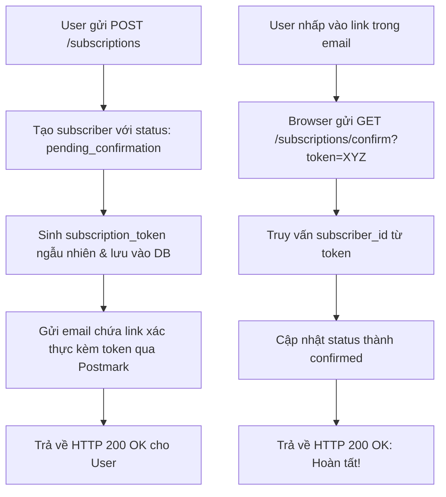

import { Callout } from "fumadocs-ui/components/callout";

Ở Chương 6, chúng ta đã trang bị cho hệ thống khả năng kiểm tra định dạng email và tên người dùng bằng Type-Driven Development. Giờ đây chúng ta có những địa chỉ email hợp lệ về mặt cú pháp (`syntactically valid`), nhưng ta hoàn toàn không biết liệu hòm thư đó có thực sự tồn tại hay không và người dùng có thực sự muốn nhận tin hay không.

Cách duy nhất để giải quyết triệt để vấn đề này là gửi một **email xác thực (confirmation email)** thực tế đến hòm thư của họ.

---

## I. Email Xác Thực & Sự Đồng Thuận Của Subscriber

Bản năng lập trình của bạn có thể đang đặt câu hỏi: *Liệu chúng ta có thực sự cần biết email có tồn tại ngay tại thời điểm đăng ký này không? Tại sao không cứ lưu vào database rồi đợi đến lần phát hành bản tin newsletter tiếp theo để kiểm tra xem họ có nhận được thư hay không?*

Nếu mục tiêu duy nhất của chúng ta chỉ là kiểm tra tính hợp lệ của dữ liệu, việc trì hoãn đến lúc gửi bản tin có vẻ hợp lý để tránh làm phức tạp hóa endpoint `POST /subscriptions`. Tuy nhiên, có một yếu tố cốt tử khác mà chúng ta **tuyệt đối không thể trì hoãn**: **sự đồng thuận của độc giả (Subscriber Consent)**.

Địa chỉ email không phải là mật khẩu bí mật. Nếu bạn tham gia Internet đủ lâu, địa chỉ email của bạn rất dễ bị lộ. Nhiều loại email (như email công việc) thậm chí còn được công khai trên các trang web và mạng xã hội.

Điều này mở ra nguy cơ bị **lạm dụng (abuse)** nghiêm trọng:
- Một kẻ phá hoại có thể dùng một địa chỉ email của nạn nhân đem đi đăng ký hàng trăm dịch vụ newsletter trên khắp Internet, khiến hòm thư của nạn nhân bị ngập chìm trong thư rác (email bomb).
- Một chủ trang web newsletter bất lương có thể dùng bot cào hàng nghìn địa chỉ email trên mạng và tự ý thêm vào danh sách gửi tin để quảng cáo spam.

<Callout type="warn" title="Ràng Buộc Pháp Lý & Tiêu Chuẩn GDPR">
Một request gửi đến `POST /subscriptions` hoàn toàn **không đủ bằng chứng** để khẳng định: *"Chủ nhân của hòm thư này đồng ý nhận nội dung của tôi!"*. Đặc biệt nếu bạn phục vụ người dùng tại thị trường Châu Âu, việc thu thập sự đồng thuận rõ ràng (explicit consent) là một **yêu cầu bắt buộc về mặt pháp lý** theo luật Bảo vệ Dữ liệu Chung (GDPR).
</Callout>

Đó là lý do mô hình **Double Opt-In** (Xác thực 2 bước) trở thành chuẩn mực công nghiệp toàn cầu: Sau khi người dùng điền biểu mẫu, hệ thống sẽ gửi một email xác thực. Chỉ khi họ nhấp vào liên kết trong email thì quá trình đăng ký mới chính thức hoàn tất.

---

## II. Hành Trình Trải Nghiệm Của Người Dùng (Confirmation User Journey)

Hãy nhìn luồng xác thực dưới góc nhìn của một độc giả:
1. Độc giả nhận được một email chứa **liên kết xác thực duy nhất (confirmation link)**.
2. Khi độc giả nhấp vào liên kết, trình duyệt mở ra và một thông báo chào mừng xuất hiện (*"Bạn đã trở thành độc giả chính thức của bản tin!"*). Kể từ giây phút đó, họ sẽ nhận được các số newsletter tiếp theo.

Ở phía backend, chúng ta sẽ thiết kế một luồng xử lý tinh gọn nhưng an toàn:



Chiến lược triển khai của chúng ta sẽ được chia thành 3 phần rõ rệt:
1. Xây dựng module gửi email (`EmailClient`) độc lập.
2. Điều chỉnh logic của endpoint `POST /subscriptions` để tích hợp việc gửi email và lưu token.
3. Xây dựng endpoint `GET /subscriptions/confirm` từ đầu.

---

## III. Xây Dựng `EmailClient` Bằng `reqwest`

Làm thế nào để một ứng dụng thực sự gửi được một email ra thế giới bên ngoài?

Giao thức nền tảng của email là **SMTP (Simple Mail Transfer Protocol)** ra đời từ năm 1982 (RFC 821). SMTP đối với email cũng tương tự như HTTP đối với các trang web. Tuy nhiên, việc tự dựng và vận hành một máy chủ SMTP riêng là một gánh nặng khổng lồ (quản lý IP reputation, chống spam, cấu hình DKIM/SPF/DMARC...).

Hầu hết các nhà cung cấp dịch vụ gửi email chuyên nghiệp ngày nay đều cung cấp hai cổng giao tiếp: **SMTP** và **REST API**. Đối với lập trình viên ứng dụng hiện đại, giao tiếp qua **REST API** tiện lợi, ổn định và dễ kiểm soát lỗi hơn rất nhiều.

### 1. Lựa Chọn Nhà Cung Cấp Email API

Trên thị trường có rất nhiều tên tuổi lớn như AWS SES, SendGrid, Mailgun, Mailchimp và Postmark. Tác giả chọn **[Postmark](https://postmarkapp.com)** vì muốn có API đơn giản, quy trình bắt đầu sử dụng thuận tiện và gói miễn phí không yêu cầu nhập thẻ tín dụng chỉ để thử nghiệm. Đây là lựa chọn của sách, không phải khuyến nghị rằng Postmark vượt trội hơn các nhà cung cấp khác. Trước khi tiếp tục, cần đăng ký Postmark và xác thực một địa chỉ người gửi đơn lẻ (single sender).

Để chuẩn bị, bạn cần tạo một tài khoản Postmark và xác thực một địa chỉ email người gửi (single sender):


---

### 2. Thiết Kế Giao Diện `EmailClient` (Interface First)

Thay vì đâm đầu vào code chi tiết, chúng ta áp dụng tư duy thiết kế từ trên xuống (Top-down): định hình chữ ký giao tiếp mong muốn trước:

```rust
//! src/email_client.rs
use crate::domain::SubscriberEmail;

pub struct EmailClient {
    sender: SubscriberEmail
}

impl EmailClient {
    pub async fn send_email(
        &self, 
        recipient: SubscriberEmail, 
        subject: &str, 
        html_content: &str,
        text_content: &str
    ) -> Result<(), String> {
        todo!()
    }
}
```

<Callout type="info" title="Vì sao cần cả HTML và Plain Text?">
Một số ứng dụng email không thể hiển thị HTML; một số người dùng cũng chủ động tắt email HTML. Gửi cả hai phiên bản giúp nội dung vẫn đọc được trong những trường hợp đó.
</Callout>

Khai báo module mới trong `src/lib.rs`:

```rust
//! src/lib.rs
pub mod configuration;
pub mod domain;
pub mod email_client; // Module mới!
pub mod routes;
pub mod startup;
pub mod telemetry;
```

---

### 3. Hiện Thực REST Client Bằng `reqwest`

Trong hệ sinh thái Rust, [`reqwest`](https://crates.io/crates/reqwest) là thư viện HTTP Client phổ biến và được kiểm chứng qua thực tế nhiều nhất. Chương này dùng `reqwest` phiên bản `0.11`; chuyển crate từ `dev-dependencies` lên `dependencies` trong `Cargo.toml`. Các lựa chọn được nêu gồm giao diện đồng bộ hoặc bất đồng bộ, triển khai Rust thuần hay binding, và executor tương thích. Ở đây chọn giao diện bất đồng bộ vì ứng dụng đã dùng `tokio` qua `actix-web`; bật `rustls-tls` thay cho `default-tls` để không phụ thuộc thư viện hệ thống.

```toml
# Cargo.toml
# [...]
[dependencies.reqwest]
version = "0.11" 
default-features = false
# Kích hoạt json và dùng rustls để độc lập với thư viện C của hệ điều hành
features = ["json", "rustls-tls"]
```

#### Connection Pooling (Tái sử dụng kết nối)
Trước mỗi request, client cần thiết lập kết nối tới server; việc này tốn kém hơn với HTTPS. Tạo kết nối mới cho từng request có thể làm giảm hiệu năng và dưới tải có thể dẫn tới cạn socket.

`reqwest::Client` khởi tạo connection pool. Dùng lại cùng một client cho nhiều request giúp tái sử dụng kết nối; gọi `Client::clone` cũng không tạo pool mới mà chỉ clone con trỏ tới pool hiện có.

```rust
//! src/email_client.rs
use crate::domain::SubscriberEmail;
use reqwest::Client;
use secrecy::Secret;

pub struct EmailClient {
    http_client: Client,
    base_url: String,
    sender: SubscriberEmail,
    authorization_token: Secret<String>,
}

impl EmailClient {
    pub fn new(
        base_url: String,
        sender: SubscriberEmail,
        authorization_token: Secret<String>,
    ) -> Self {
        Self {
            http_client: Client::new(),
            base_url,
            sender,
            authorization_token,
        }
    }
}
```

#### Tái Sử Dụng Trong Actix-Web
Để dùng lại cùng `EmailClient` trong các request của `actix-web`, ta có thể đặt nó trong application context và lấy ra bằng extractor `web::Data`. Có hai cách: derive `Clone` cho client và truyền bản clone vào `app_data`, hoặc bọc client bằng `Data` (dùng `Arc`) rồi clone `Data` cho từng `App`. Ở đây chọn cách thứ hai vì ngoài `Client`, `EmailClient` còn giữ `base_url` và `sender`; cách này chia sẻ cả các giá trị ấy giữa các `App`. Tác giả cũng lưu ý rằng chi phí cấp phát chuỗi hay clone con trỏ là nhỏ trong bối cảnh tổng thể.

```rust
//! src/startup.rs
use crate::email_client::EmailClient;
use actix_web::web::Data;

pub fn run(
    listener: TcpListener,
    db_pool: PgPool,
    email_client: EmailClient,
) -> Result<Server, std::io::Error> {
    let db_pool = Data::new(db_pool);
    let email_client = Data::new(email_client);
    let server = HttpServer::new(move || {
        App::new()
            .wrap(TracingLogger::default())
            .route("/health_check", web::get().to(health_check))
            .route("/subscriptions", web::post().to(subscribe))
            .app_data(db_pool.clone())
            .app_data(email_client.clone())
    })
    .listen(listener)?
    .run();
    Ok(server)
}
```

---

## IV. Kiểm Thử HTTP Client Độc Lập Với `wiremock`

Làm thế nào để kiểm thử phương thức `send_email` mà không phải gửi hàng nghìn email rác thật đến Postmark làm cạn kiệt hạn ngạch tài khoản?

Ta cần một **Mock Server** chạy trên localhost để chặn các request HTTP đi ra. Chương này dùng crate [`wiremock`](https://github.com/lukemathwalker/wiremock-rs) để thực hiện việc đó.

```toml
# Cargo.toml
# [...]
[dev-dependencies]
wiremock = "0.5"
tokio = { version = "1", features = ["rt", "macros"] }
```

Hãy xem bài test đầu tiên kiểm tra xem `send_email` có thực sự bắn request HTTP tới đúng URL mong đợi hay không:

```rust
//! src/email_client.rs
// [...]

#[cfg(test)]
mod tests {
    use crate::domain::SubscriberEmail;
    use crate::email_client::EmailClient;
    use fake::faker::internet::en::SafeEmail;
    use fake::faker::lorem::en::{Paragraph, Sentence};
    use fake::{Fake, Faker};
    use secrecy::Secret;
    use wiremock::matchers::any;
    use wiremock::{Mock, MockServer, ResponseTemplate};

    #[tokio::test]
    async fn send_email_fires_a_request_to_base_url() {
        // Arrange: Khởi động MockServer ngẫu nhiên trên cổng trống
        let mock_server = MockServer::start().await;
        let sender = SubscriberEmail::parse(SafeEmail().fake()).unwrap();
        let email_client = EmailClient::new(
            mock_server.uri(),
            sender,
            Secret::new(Faker.fake()),
        );

        // Thiết lập kỳ vọng: Mọi request gửi tới mock_server phải nhận được phản hồi 200 OK
        // và kỳ vọng có chính xác 1 request được kích hoạt (.expect(1))
        Mock::given(any())
            .respond_with(ResponseTemplate::new(200))
            .expect(1)
            .mount(&mock_server)
            .await;

        let subscriber_email = SubscriberEmail::parse(SafeEmail().fake()).unwrap();
        let subject: String = Sentence(1..2).fake();
        let content: String = Paragraph(1..10).fake();

        // Act: Thực hiện gửi email
        let _ = email_client
            .send_email(&subscriber_email, &subject, &content, &content)
            .await;

        // Assert: MockServer tự động xác nhận số lượng request khi đối tượng bị drop!
    }
}
```

<Callout type="info" title="Sức Mạnh Của wiremock::Mock::expect">
Phương thức `.expect(1)` đảm bảo rằng nếu hàm `send_email` của chúng ta gặp bug logic mà không hề bắn request nào ra mạng, hoặc vô tình bắn 2 lần trong vòng lặp vô tận, bài test sẽ lập tức báo lỗi ngay khi `mock_server` kết thúc!
</Callout>

---

## V. Hoàn Thiện `EmailClient::send_email` & Thắt Chặt Test

Theo đặc tả tài liệu của Postmark, request gửi đi cần tuân thủ cấu trúc JSON:
- Endpoint: `POST /email`
- Header: `X-Postmark-Server-Token: <token>`
- Body:
  ```json
  {
    "From": "sender@domain.com",
    "To": "recipient@domain.com",
    "Subject": "Hello",
    "HtmlBody": "<p>Hello</p>",
    "TextBody": "Hello"
  }
  ```

Triển khai phương thức trong `src/email_client.rs`:

```rust
//! src/email_client.rs
// [...]

#[derive(serde::Serialize)]
#[serde(rename_all = "PascalCase")]
struct SendEmailRequest<'a> {
    from: &'a str,
    to: &'a str,
    subject: &'a str,
    html_body: &'a str,
    text_body: &'a str,
}

impl EmailClient {
    // [...]
    pub async fn send_email(
        &self,
        recipient: &SubscriberEmail,
        subject: &str,
        html_content: &str,
        text_content: &str,
    ) -> Result<(), reqwest::Error> {
        let url = format!("{}/email", self.base_url);
        let request_body = SendEmailRequest {
            from: self.sender.as_ref(),
            to: recipient.as_ref(),
            subject,
            html_body: html_content,
            text_body: text_content,
        };
        self.http_client
            .post(&url)
            .header(
                "X-Postmark-Server-Token",
                self.authorization_token.expose_secret(),
            )
            .json(&request_body)
            .send()
            .await?
            .error_for_status()?;
        Ok(())
    }
}
```

<Callout type="info" title="Tránh cấp phát chuỗi không cần thiết">
`SendEmailRequest<'a>` giữ các trường dưới dạng `&'a str` thay vì tạo các `String` mới bằng `to_owned`. Nhờ vậy không cần cấp phát và sao chép từng chuỗi chỉ để dựng request body.
</Callout>

### Kiểm thử request, lỗi HTTP và timeout

Bài test ban đầu chỉ dùng matcher `any()` và `.expect(1)` để xác nhận có đúng một request. Sau đó, siết điều kiện theo từng phần: header `X-Postmark-Server-Token` tồn tại, `Content-Type` là `application/json`, path là `/email`, method là `POST`. Với body, test dùng custom `wiremock::Match`: parse request bytes bằng `serde_json`, rồi xác nhận có đủ các key `From`, `To`, `Subject`, `HtmlBody`, `TextBody`. Lần đầu matcher thất bại vì `serde` phát ra key snake_case; thêm `#[serde(rename_all = "PascalCase")]` khiến test khớp với định dạng Postmark. Test được đổi tên thành `send_email_sends_the_expected_request`.

`reqwest::Response::error_for_status` là cần thiết: `send().await` chỉ báo lỗi gửi request/kết nối/redirect, không trả `Err` chỉ vì server phản hồi status 4xx hoặc 5xx. Test với status 500 cho thấy điều đó và xác nhận thêm `.error_for_status()?` để chuyển response lỗi thành error.

1. **Lỗi máy chủ trả về mã HTTP 500**:
   ```rust
   Mock::given(any())
       .respond_with(ResponseTemplate::new(500))
       .expect(1)
       .mount(&mock_server)
       .await;

   let outcome = email_client
       .send_email(&subscriber_email, &subject, &content, &content)
       .await;

   claims::assert_err!(outcome);
   ```

2. **Timeout khi server phản hồi chậm**:
   Test ban đầu dùng `wiremock` delay 180 giây nhưng không cấu hình timeout, nên phải chờ rất lâu và giữ connection bận; khi nhiều request như vậy tích tụ, có thể gây suy giảm hiệu năng hoặc cạn socket. Nguyên tắc rút ra là đặt timeout cho mọi thao tác I/O. `reqwest` cho phép đặt timeout toàn client hoặc từng request; sách chọn timeout toàn client 10 giây trong `EmailClient::new`:
   ```rust
   let http_client = Client::builder()
       .timeout(std::time::Duration::from_secs(10))
       .build()
       .unwrap();
   ```

   Để test chạy nhanh, thêm `timeout: std::time::Duration` vào constructor, lấy cấu hình từ `timeout_milliseconds` trong `EmailClientSettings`, đặt giá trị cấu hình mẫu là `10000`, và dùng 200ms trong test helper. Khi đó test delay 180 giây nhận `Err` sau khoảng 200ms; toàn bộ test suite trong sách chạy dưới một giây.

### Chi tiết vòng lặp kiểm thử `EmailClient`

Mock server mặc định trả `404 Not Found` cho request không khớp mock nào. `Mock::given(any())` khớp mọi request, bất kể method, path, header hay body; `respond_with(ResponseTemplate::new(200))` trả `200 OK` không có body. Mock chỉ hoạt động sau khi được `.mount(&mock_server)`. Kỳ vọng `.expect(1)` yêu cầu đúng một request khớp; cũng có thể dùng `expect(1..)` cho ít nhất một request hoặc `expect(1..=3)` cho từ một đến ba request. Wiremock kiểm tra kỳ vọng khi `MockServer` bị drop lúc kết thúc test và panic nếu số lượng không đúng.

Ban đầu test dùng `todo!()` nên thất bại với `not yet implemented`. Thay tạm phần thân `send_email` bằng `Ok(())` giúp chạy tới cuối test, khi đó Wiremock báo kỳ vọng một request nhưng nhận được không. Hai thất bại này xác nhận test đã kiểm tra cả việc gọi code lẫn side effect HTTP, chứ không chỉ kiểm tra giá trị trả về.

Trong test này, dữ liệu đầu vào được sinh bằng `fake`: địa chỉ từ `SafeEmail`, subject từ `Sentence(1..2)`, nội dung từ `Paragraph(1..10)`. Dữ liệu ngẫu nhiên làm rõ rằng giá trị cụ thể không ảnh hưởng đến thuộc tính đang kiểm tra. Với dữ liệu cố định, người đọc có thể tự hỏi liệu test có phụ thuộc nhầm vào một giá trị cụ thể hay không.

Sau khi hoàn thiện request, có thể tăng độ chính xác của test bằng các matcher sau:

```rust
use wiremock::matchers::{header, header_exists, method, path};

Mock::given(header_exists("X-Postmark-Server-Token"))
    .and(header("Content-Type", "application/json"))
    .and(path("/email"))
    .and(method("POST"))
    .and(SendEmailBodyMatcher)
    .respond_with(ResponseTemplate::new(200))
    .expect(1)
    .mount(&mock_server)
    .await;
```

Matcher cho body cần kiểm tra JSON hợp lệ và các trường bắt buộc, nhưng không cần so sánh giá trị từng trường:

```rust
use wiremock::Request;

struct SendEmailBodyMatcher;

impl wiremock::Match for SendEmailBodyMatcher {
    fn matches(&self, request: &Request) -> bool {
        let result: Result<serde_json::Value, _> =
            serde_json::from_slice(&request.body);
        if let Ok(body) = result {
            body.get("From").is_some()
                && body.get("To").is_some()
                && body.get("Subject").is_some()
                && body.get("HtmlBody").is_some()
                && body.get("TextBody").is_some()
        } else {
            false
        }
    }
}
```

Để viết matcher này cần thêm `serde_json = "1"` vào `dev-dependencies`. Lần đầu test không khớp; thêm `dbg!(&body)` cho thấy JSON có các key `from`, `to`, `subject`, `html_body`, `text_body` ở snake_case. Postmark yêu cầu PascalCase, nên kiểu request cần `#[serde(rename_all = "PascalCase")]`. Sau đó đổi tên test thành `send_email_sends_the_expected_request`, phản ánh đúng việc nó kiểm tra toàn bộ request.

Mẫu API của Postmark cho thấy request `POST https://api.postmarkapp.com/email` có `Accept: application/json`, `Content-Type: application/json`, header `X-Postmark-Server-Token` và JSON gồm `From`, `To`, `Subject`, `TextBody`, `HtmlBody`. Phản hồi thành công mẫu là `HTTP/1.1 200 OK` với JSON chứa `To`, `SubmittedAt`, `MessageID`, `ErrorCode: 0`, `Message: "OK"`. Phần triển khai chỉ cần kiểm tra status; không deserialize response body.

Khi gọi `.send().await?`, compiler ban đầu báo không thể chuyển `reqwest::Error` thành `String`: `String` chỉ là kiểu placeholder được chọn để phác thảo interface. Đổi chữ ký sang `Result<(), reqwest::Error>` giải quyết lỗi kiểu. Cần lưu authorization token trong `EmailClient` dưới dạng `secrecy::Secret<String>` để tránh vô tình log secret; cấu hình `EmailClientSettings` cũng nhận trường này. Chỉ cấu hình token phát triển trong `base.yaml`; production token phải được cung cấp ngoài version control vì là secret. Header được tạo bằng `self.authorization_token.expose_secret()`.

`send().await?` chỉ trả lỗi khi gửi request thất bại, gặp redirect loop hoặc vượt giới hạn redirect; một phản hồi HTTP 500 vẫn là `Ok(Response)`. Vì vậy, sau `send().await?` phải gọi `.error_for_status()?` để các status lỗi trở thành `reqwest::Error`. Test 200 dùng `claims::assert_ok!`; test 500 dùng `claims::assert_err!`. Test chỉ thiết lập matcher `any()` tối thiểu vì mục tiêu ở đây là kiểm tra kết quả của `send_email`, không phải lặp lại assertions về hình dạng request.

### Timeout và test helpers

Test delay của Wiremock dùng `ResponseTemplate::new(200).set_delay(Duration::from_secs(180))`. Không có timeout, test vẫn chạy sau 60 giây và kết nối tiếp tục bận; nhiều request treo có thể khiến client mở thêm kết nối, gây suy giảm hiệu năng hoặc socket exhaustion. Quy tắc thực hành là đặt timeout cho mọi thao tác I/O. Có thể đặt timeout dùng chung trên `Client` hoặc timeout riêng từng request; ở đây timeout mặc định của client là 10 giây:

```rust
let http_client = Client::builder()
    .timeout(std::time::Duration::from_secs(10))
    .build()
    .unwrap();
```

Thời gian 10 giây làm test chờ lâu, nên đưa `timeout: std::time::Duration` thành tham số của `EmailClient::new`, thêm `timeout_milliseconds: u64` vào `EmailClientSettings` cùng hàm chuyển sang `Duration::from_millis`, và cấu hình `10000` trong `base.yaml`. Test helper khởi tạo client với timeout 200ms; test response delay 180 giây khi đó phải nhận `Err` sau khoảng 200ms. Constructor production nhận timeout từ configuration, và test tích hợp cũng truyền `configuration.email_client.timeout()`.

Bốn test của client có thể dùng chung các helper sinh subject, content, email và client:

```rust
fn subject() -> String { Sentence(1..2).fake() }
fn content() -> String { Paragraph(1..10).fake() }
fn email() -> SubscriberEmail {
    SubscriberEmail::parse(SafeEmail().fake()).unwrap()
}
fn email_client(base_url: String) -> EmailClient {
    EmailClient::new(
        base_url,
        email(),
        Secret::new(Faker.fake()),
        std::time::Duration::from_millis(200),
    )
}
```

Nhờ vậy, test request chỉ còn phần Arrange (MockServer và matcher), Act (gọi `send_email`) và Assert (kỳ vọng mock được kiểm tra khi drop). Cấu hình timeout kiểm thử thấp giúp toàn bộ test suite trong ví dụ của sách hoàn tất dưới một giây.

Toàn bộ các unit test của `EmailClient` đều hoạt động chính xác và bao phủ trường hợp thành công lẫn các ca lỗi biên mạng. Bây giờ, trước khi tích hợp `EmailClient` vào luồng ứng dụng chính, chúng ta cần dừng lại để xem xét cấu trúc bộ kiểm thử tích hợp (integration tests) của toàn dự án.
