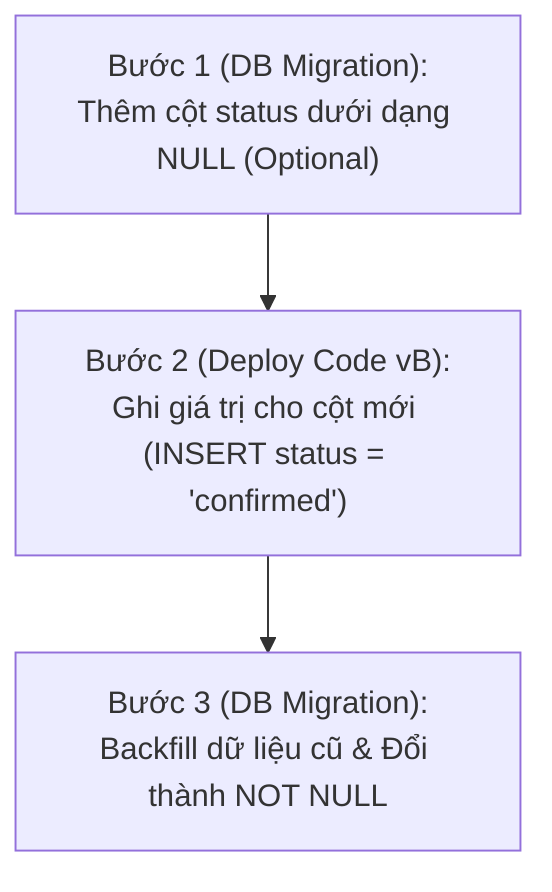

import { Callout } from "fumadocs-ui/components/callout";

Sau khi hoàn thành `EmailClient` và tái cấu trúc bộ test suite tích hợp, chúng ta đã sẵn sàng bước vào nhiệm vụ tiếp theo: **lưu trạng thái đăng ký của độc giả và gửi liên kết xác thực**.

Để làm được điều đó, chúng ta cần bổ sung thêm một trường mới mang tên `status` vào bảng `subscriptions` (để phân biệt giữa `pending_confirmation` và `confirmed`), đồng thời tạo thêm một bảng mới để lưu trữ các mã xác thực (`subscription_tokens`).

Ứng dụng đã được triển khai lên cloud ở Chương 5 và hiện có thể nhận đăng ký. Vì phiên bản cũ và mới có thể cùng chạy trong lúc rollout, thay đổi schema cần được triển khai theo các bước tương thích với cả hai phiên bản.

---

## I. Độ Tin Cậy & Zero Downtime Deployments

### 1. Chỉ Số Khả Dụng & Thỏa Thuận Mức Dịch Vụ (SLA)

Khi một ứng dụng bắt đầu phục vụ người dùng thực tế trên môi trường production, **tính tin cậy (reliability)** trở thành thước đo số một.

Trong các hợp đồng thương mại, độ tin cậy thường được cụ thể hóa bằng một cam kết pháp lý mang tên **SLA (Service Level Agreement)**. Ví dụ: dịch vụ của bạn cam kết độ khả dụng đạt **"bốn số 9" (99.99% availability)**.

<Callout type="info" title="Bốn số 9 về availability">
Availability 99.99% tương ứng tối đa khoảng 52 phút downtime mỗi năm, nếu giả định lượng request phân bố đều theo thời gian. Đạt được mức này đòi hỏi nỗ lực ở nhiều lớp, từ ứng dụng đến hạ tầng; không có một giải pháp đơn lẻ nào bảo đảm high availability.
</Callout>

Do đó, bất kỳ hệ thống hiện đại nào cũng bắt buộc phải làm chủ kỹ thuật **triển khai không gián đoạn (Zero Downtime Deployments)**: người dùng hoàn toàn có thể sử dụng dịch vụ bình thường trước, trong và sau thời điểm phiên bản mới được triển khai.

---

### 2. Các Chiến Lược Triển Khai

#### Cách Tiếp Cận Ngây Thơ (Naive Deployment)
Giả sử phiên bản `A` đang chạy trên cụm máy chủ và bạn muốn nâng cấp lên phiên bản `B`:
1. Bạn tắt toàn bộ các instance đang chạy phiên bản `A`.
2. Bạn bật các instance mới chạy phiên bản `B`.
3. Bạn bắt đầu cho phiên bản `B` tiếp nhận request.

Trong khoảng thời gian chuyển giao giữa bước 1 và bước 2, **hoàn toàn không có máy chủ nào chạy để phục vụ người dùng** — hệ thống của bạn rơi vào trạng thái ngừng hoạt động (downtime) và mọi request gửi đến đều bị lỗi kết nối!

#### Bộ Cân Bằng Tải (Load Balancers)
Để loại bỏ thời gian chết, hệ thống production luôn chạy nhiều bản sao (replicas) của ứng dụng nằm phía sau một **bộ cân bằng tải (Load Balancer)**:


Mỗi bản sao ứng dụng được đăng ký với Load Balancer như một **backend**. Khi có request gửi đến từ Internet, Load Balancer sẽ điều phối request đó tới một trong những backend đang rảnh rỗi.

Load Balancer có thể giám sát sức khỏe backend theo hai cách:
- **Passive Health Check**: dựa trên phân bố status code hoặc latency của từng backend.
- **Active Health Check**: gửi request kiểm tra theo lịch. Nếu backend không trả về success trong một khoảng thời gian đủ lâu, nó bị đánh dấu unhealthy và bị loại khỏi danh sách backend.

Đây là một phần quan trọng của khả năng **self-healing**; việc tự động tạo replica thay thế còn phụ thuộc vào năng lực của nền tảng.

---

### 3. Chiến Lược Triển Khai Cuốn Chiếu (Rolling Update Deployments)

Nhờ có Load Balancer, chúng ta có thể thực hiện nâng cấp phiên bản bằng kỹ thuật **Rolling Update**:

**Bước 1: Trạng thái ban đầu**  
Hệ thống đang chạy 3 bản sao của phiên bản `A` đằng sau Load Balancer:


**Bước 2: Khởi động bản sao phiên bản mới**  
Chúng ta bật một instance chạy phiên bản `B`. Khi instance này khởi động xong và vượt qua các bài kiểm tra health check, nó sẽ được đăng ký vào Load Balancer. Lúc này, có tổng cộng 4 instances đang cùng phục vụ lưu lượng truy cập thực tế (3 bản A và 1 bản B):


**Bước 3: Tắt dần bản sao phiên bản cũ**  
Sau khi instance `B` sẵn sàng, ta tắt một instance `A`. Lặp lại quy trình để thay dần các replica cũ:


Quá trình này lặp lại tuần tự cho đến khi mọi backend đã chạy phiên bản `B`. Đây là chiến lược **rolling update**: phiên bản cũ và mới chạy song song, cùng phục vụ lưu lượng thực tế. Trong điều kiện phiên bản `B` không có lỗi, luôn có ít nhất 3 backend khỏe mạnh nên người dùng không bị gián đoạn dịch vụ.

---

## II. Nghịch Lý Giữa Ứng Dụng Stateless & Cơ Sở Dữ Liệu Stateful

Chiến lược Rolling Update vận hành trơn tru đối với tầng ứng dụng vì các web server của chúng ta là **vô trạng thái (stateless)**: ta có thể tùy ý bật hoặc tắt chúng bất cứ lúc nào.

Thế nhưng, toàn bộ trạng thái của hệ thống lại được lưu trữ tập trung tại **cơ sở dữ liệu (stateful)**!

```text
[App vA (Cũ)] ──┐
                ├──► [ DUY NHẤT 1 CƠ SỞ DỮ LIỆU POSTGRESQL ]
[App vB (Mới)] ──┘
```

<Callout type="error" title="Tương thích schema trong rolling update">
Trong rollout, phiên bản cũ (vA) và mới (vB) cùng dùng một database. Nếu thêm cột `NOT NULL` trước khi triển khai code mới, vA sẽ tiếp tục INSERT mà không cung cấp giá trị cho cột đó và thao tác ghi sẽ lỗi. Nếu triển khai code mới trước migration, vB sẽ truy vấn/ghi cột chưa tồn tại và cũng lỗi.
</Callout>

Vì vậy, cần tách thay đổi schema và thay đổi hành vi ứng dụng thành các bước nhỏ, sao cho schema tạm thời vẫn dùng được với cả hai phiên bản.

---

## III. Kỹ Thuật Multi-Step Migrations: Thêm Cột Bắt Buộc (`NOT NULL`)

Chúng ta cần thêm cột `status` vào bảng `subscriptions`, và về lâu dài cột này phải là bắt buộc (`NOT NULL`). Nhưng bảng `subscriptions` hiện tại đang chứa dữ liệu của các độc giả đã đăng ký từ trước.

Để thực hiện điều này một cách an toàn mà không gây downtime, chúng ta chia thành **3 bước độc lập**:



### Bước 1: Thêm Cột Dưới Dạng Optional (`NULL`)

Chúng ta giữ nguyên mã nguồn ứng dụng hiện tại, và tạo một file migration mới bằng SQLx CLI:

```bash
sqlx migrate add add_status_to_subscriptions
```

Nội dung file SQL:

```sql
-- migrations/20210307181858_add_status_to_subscriptions.sql
ALTER TABLE subscriptions ADD COLUMN status TEXT NULL;
```

Theo sách, chạy migration trên database cục bộ bằng `SKIP_DOCKER=true ./scripts/init_db.sh`, rồi chạy test suite để kiểm tra code hiện tại với schema mới; sau đó mới migrate production. Vì cột mới cho phép `NULL`, code cũ vẫn có thể ghi mà không chỉ định giá trị này.

---

### Bước 2: Cập Nhật Ứng Dụng Bắt Đầu Ghi Giá Trị Cho Cột Mới

Giờ đây cột `status` đã tồn tại trong database, chúng ta có thể cập nhật mã nguồn ứng dụng trong `src/routes/subscriptions.rs` để bắt đầu ghi nhận giá trị cho cột này mỗi khi có người đăng ký mới:

```rust
//! src/routes/subscriptions.rs
// [...]

pub async fn insert_subscriber(
    pool: &PgPool,
    new_subscriber: &NewSubscriber,
) -> Result<(), sqlx::Error> {
    sqlx::query!(
        r#"
        INSERT INTO subscriptions (id, email, name, subscribed_at, status)
        VALUES ($1, $2, $3, $4, 'confirmed')
        "#,
        Uuid::new_v4(),
        new_subscriber.email.as_ref(),
        new_subscriber.name.as_ref(),
        Utc::now()
    )
    .execute(pool)
    .await
    .map_err(|e| {
        tracing::error!("Failed to execute query: {:?}", e);
        e
    })?;
    Ok(())
}
```

Chúng ta chạy bộ test suite và triển khai phiên bản code mới này lên production bằng Rolling Update. Lúc này, toàn bộ các bản ghi mới phát sinh đều đã có giá trị `status = 'confirmed'`.

---

### Bước 3: Điền Dữ Liệu Cũ (Backfill) & Đánh Dấu `NOT NULL`

Sau khi rollout phiên bản mới hoàn tất, các bản ghi mới đều có `status`; những bản ghi lịch sử vẫn có thể là `NULL`. Ta backfill các bản ghi đó rồi đặt ràng buộc `NOT NULL`. Theo sách, migration này được bọc trong transaction tường minh (SQLx không tự làm điều đó cho migration này):

```bash
sqlx migrate add make_status_not_null_in_subscriptions
```

Nội dung file migration:

```sql
-- migrations/20210307184428_make_status_not_null_in_subscriptions.sql
-- Bọc toàn bộ migration trong một Database Transaction để đảm bảo tính nguyên tử
BEGIN;
    -- Điền giá trị mặc định cho toàn bộ dữ liệu lịch sử
    UPDATE subscriptions 
        SET status = 'confirmed' 
        WHERE status IS NULL;

    -- Chính thức nâng cấp cột lên NOT NULL
    ALTER TABLE subscriptions 
        ALTER COLUMN status SET NOT NULL;
COMMIT;
```

Chạy migration trên database cục bộ và kiểm thử trước khi áp dụng lên production; sau đó cột `status` đã được backfill và đặt thành `NOT NULL`.

---

## IV. Tạo Bảng Lưu Trữ Token Xác Thực (`subscription_tokens`)

Bên cạnh cột `status`, chúng ta cần thêm một bảng mới để lưu trữ các token xác thực liên kết với từng độc giả:

```bash
sqlx migrate add create_subscription_tokens_table
```

```sql
-- migrations/20210307185000_create_subscription_tokens_table.sql
CREATE TABLE subscription_tokens(
    subscription_token TEXT NOT NULL,
    subscriber_id UUID NOT NULL 
        REFERENCES subscriptions (id),
    PRIMARY KEY (subscription_token)
);
```

<Callout type="info" title="Thiết Kế Khóa Chính & Khóa Ngoại Thông Minh">
- `subscription_token` đóng vai trò là **PRIMARY KEY** (Khóa chính) để tối ưu tốc độ tìm kiếm khi độc giả nhấp vào liên kết xác thực `GET /subscriptions/confirm?token=XYZ`.
- `subscriber_id` là khóa ngoại tham chiếu đến `subscriptions(id)`, bảo đảm mỗi token được gắn với một subscriber tồn tại.
</Callout>

Cơ sở dữ liệu của chúng ta giờ đây đã được trang bị đầy đủ các bảng và cột cần thiết. Ở bài học tiếp theo, chúng ta sẽ bắt tay vào việc sinh mã xác thực ngẫu nhiên và gửi email thực tế đến độc giả!
