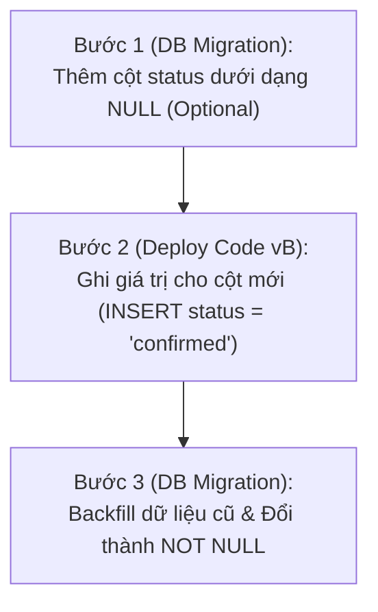

import { Callout } from "fumadocs-ui/components/callout";

Sau khi hoàn thành `EmailClient` và tái cấu trúc bộ test suite tích hợp, chúng ta đã sẵn sàng bước vào nhiệm vụ tiếp theo: **lưu trạng thái đăng ký của độc giả và gửi liên kết xác thực**.

Để làm được điều đó, chúng ta cần bổ sung thêm một trường mới mang tên `status` vào bảng `subscriptions` (để phân biệt giữa `pending_confirmation` và `confirmed`), đồng thời tạo thêm một bảng mới để lưu trữ các mã xác thực (`subscription_tokens`).

Thế nhưng, ứng dụng của chúng ta hiện **đã được triển khai lên môi trường production thực tế** (ở Chương 5). Chúng ta không thể đơn giản gõ lệnh `ALTER TABLE` một cách tùy tiện trên database đang chạy trực tiếp. Bất kỳ một bước đi bất cẩn nào cũng có thể làm sập toàn bộ dịch vụ đang phục vụ người dùng!

---

## I. Độ Tin Cậy & Zero Downtime Deployments

### 1. Chỉ Số Khả Dụng & Thỏa Thuận Mức Dịch Vụ (SLA)

Khi một ứng dụng bắt đầu phục vụ người dùng thực tế trên môi trường production, **tính tin cậy (reliability)** trở thành thước đo số một.

Trong các hợp đồng thương mại, độ tin cậy thường được cụ thể hóa bằng một cam kết pháp lý mang tên **SLA (Service Level Agreement)**. Ví dụ: dịch vụ của bạn cam kết độ khả dụng đạt **"bốn số 9" (99.99% availability)**.

<Callout type="warn" title="Four Nines of Availability (99.99%) Nghĩa Là Gì?">
Độ khả dụng 99.99% đồng nghĩa với việc: trong suốt 365 ngày của một năm, tổng thời gian hệ thống của bạn được phép ngừng hoạt động (downtime) **không được vượt quá 52 phút**! 

Nếu bạn triển khai phần mềm theo kiểu cũ (mỗi lần cập nhật phiên bản mới là phải tắt máy chủ 5-10 phút), bạn sẽ làm cạn kiệt toàn bộ "ngân sách lỗi" (error budget) của cả năm chỉ sau vài lần phát hành bản vá!
</Callout>

Do đó, bất kỳ hệ thống hiện đại nào cũng bắt buộc phải làm chủ kỹ thuật **triển khai không gián đoạn (Zero Downtime Deployments)**: người dùng hoàn toàn có thể sử dụng dịch vụ bình thường trước, trong và sau thời điểm phiên bản mới được triển khai.

---

### 2. Các Chiến Lược Triển Khai

#### Cách Tiếp Cận Ngây Thơ (Naive Deployment)
Giả sử phiên bản `A` đang chạy trên cụm máy chủ và bạn muốn nâng cấp lên phiên bản `B`:
1. Bạn tắt toàn bộ các instance đang chạy phiên bản `A`.
2. Bạn bật các instance mới chạy phiên bản `B`.
3. Bạn bắt đầu cho phiên bản `B` tiếp nhận request.

Trong khoảng thời gian chuyển giao giữa bước 1 và bước 2, **hoàn toàn không có máy chủ nào chạy để phục vụ người dùng** — hệ thống của bạn rơi vào trạng thái ngừng hoạt động (downtime) và mọi request gửi đến đều bị lỗi kết nối!

#### Bộ Cân Bằng Tải (Load Balancers)
Để loại bỏ thời gian chết, hệ thống production luôn chạy nhiều bản sao (replicas) của ứng dụng nằm phía sau một **bộ cân bằng tải (Load Balancer)**:


Mỗi bản sao ứng dụng được đăng ký với Load Balancer như một **backend**. Khi có request gửi đến từ Internet, Load Balancer sẽ điều phối request đó tới một trong những backend đang rảnh rỗi.

Load Balancer liên tục giám sát sức khỏe của các backend thông qua cơ chế **Health Check**:
- **Passive Health Check**: Load Balancer theo dõi tỷ lệ lỗi hoặc độ trễ phản hồi của từng backend.
- **Active Health Check**: Load Balancer định kỳ gửi một HTTP request tới endpoint kiểm tra (chẳng hạn như `/health_check` mà chúng ta đã xây dựng). Nếu một backend không phản hồi hoặc trả về mã lỗi, Load Balancer sẽ lập tức gạch tên nó ra khỏi danh sách điều phối, giúp hệ thống đạt khả năng **tự chữa lành (self-healing)**.

---

### 3. Chiến Lược Triển Khai Cuốn Chiếu (Rolling Update Deployments)

Nhờ có Load Balancer, chúng ta có thể thực hiện nâng cấp phiên bản bằng kỹ thuật **Rolling Update**:

**Bước 1: Trạng thái ban đầu**  
Hệ thống đang chạy 3 bản sao của phiên bản `A` đằng sau Load Balancer:


**Bước 2: Khởi động bản sao phiên bản mới**  
Chúng ta bật một instance chạy phiên bản `B`. Khi instance này khởi động xong và vượt qua các bài kiểm tra health check, nó sẽ được đăng ký vào Load Balancer. Lúc này, có tổng cộng 4 instances đang cùng phục vụ lưu lượng truy cập thực tế (3 bản A và 1 bản B):


**Bước 3: Tắt dần bản sao phiên bản cũ**  
Load Balancer ngừng điều phối request tới một instance phiên bản `A`, đợi nó xử lý nốt các request đang dang dở rồi tắt bỏ (decommission):


Quá trình này lặp lại tuần tự cho đến khi toàn bộ các instance phiên bản `A` được thay thế hoàn toàn bởi phiên bản `B`. Trong suốt quá trình này, luôn có ít nhất 3 instance khỏe mạnh phục vụ người dùng — **hoàn toàn không có một mili-giây downtime nào xảy ra!**

---

## II. Nghịch Lý Giữa Ứng Dụng Stateless & Cơ Sở Dữ Liệu Stateful

Chiến lược Rolling Update vận hành trơn tru đối với tầng ứng dụng vì các web server của chúng ta là **vô trạng thái (stateless)**: ta có thể tùy ý bật hoặc tắt chúng bất cứ lúc nào.

Thế nhưng, toàn bộ trạng thái của hệ thống lại được lưu trữ tập trung tại **cơ sở dữ liệu (stateful)**!

```text
[App vA (Cũ)] ──┐
                ├──► [ DUY NHẤT 1 CƠ SỞ DỮ LIỆU POSTGRESQL ]
[App vB (Mới)] ──┘
```

<Callout type="error" title="Cạm Bẫy Chết Người Của Việc Thay Đổi Schema">
Trong suốt quá trình Rolling Update diễn ra, **phiên bản ứng dụng cũ (vA) và phiên bản ứng dụng mới (vB) cùng lúc kết nối vào DUY NHẤT MỘT cơ sở dữ liệu!**
- Nếu bạn chạy Migration cập nhật database **TRƯỚC**: Phiên bản ứng dụng cũ (vA) vẫn đang chạy có thể không hiểu cấu trúc bảng mới hoặc bị gãy các câu lệnh SQL, gây sập dịch vụ.
- Nếu bạn chạy Migration cập nhật database **SAU**: Phiên bản ứng dụng mới (vB) khi vừa được bật lên sẽ lập tức phát nổ vì các cột hoặc bảng mà nó mong đợi chưa hề tồn tại trong cơ sở dữ liệu!
</Callout>

Giải pháp duy nhất cho nghịch lý này là: **Mọi thay đổi trong cơ sở dữ liệu đều phải tương thích ngược (backwards-compatible)** thông qua kỹ thuật **Migration Đa Bước (Multi-step Migrations)**.

---

## III. Kỹ Thuật Multi-Step Migrations: Thêm Cột Bắt Buộc (`NOT NULL`)

Chúng ta cần thêm cột `status` vào bảng `subscriptions`, và về lâu dài cột này phải là bắt buộc (`NOT NULL`). Nhưng bảng `subscriptions` hiện tại đang chứa dữ liệu của các độc giả đã đăng ký từ trước.

Để thực hiện điều này một cách an toàn mà không gây downtime, chúng ta chia thành **3 bước độc lập**:



### Bước 1: Thêm Cột Dưới Dạng Optional (`NULL`)

Chúng ta giữ nguyên mã nguồn ứng dụng hiện tại, và tạo một file migration mới bằng SQLx CLI:

```bash
sqlx migrate add add_status_to_subscriptions
```

Nội dung file SQL:

```sql
-- migrations/20210307181858_add_status_to_subscriptions.sql
ALTER TABLE subscriptions ADD COLUMN status TEXT NULL;
```

Chạy migration này trên database. Vì cột `status` cho phép giá trị `NULL`, nên phiên bản ứng dụng cũ (vA) vẫn tiếp tục đọc và ghi bình thường mà không bị ảnh hưởng gì cả!

---

### Bước 2: Cập Nhật Ứng Dụng Bắt Đầu Ghi Giá Trị Cho Cột Mới

Giờ đây cột `status` đã tồn tại trong database, chúng ta có thể cập nhật mã nguồn ứng dụng trong `src/routes/subscriptions.rs` để bắt đầu ghi nhận giá trị cho cột này mỗi khi có người đăng ký mới:

```rust
//! src/routes/subscriptions.rs
// [...]

pub async fn insert_subscriber(
    pool: &PgPool,
    new_subscriber: &NewSubscriber,
) -> Result<(), sqlx::Error> {
    sqlx::query!(
        r#"
        INSERT INTO subscriptions (id, email, name, subscribed_at, status)
        VALUES ($1, $2, $3, $4, 'confirmed')
        "#,
        Uuid::new_v4(),
        new_subscriber.email.as_ref(),
        new_subscriber.name.as_ref(),
        Utc::now()
    )
    .execute(pool)
    .await
    .map_err(|e| {
        tracing::error!("Failed to execute query: {:?}", e);
        e
    })?;
    Ok(())
}
```

Chúng ta chạy bộ test suite và triển khai phiên bản code mới này lên production bằng Rolling Update. Lúc này, toàn bộ các bản ghi mới phát sinh đều đã có giá trị `status = 'confirmed'`.

---

### Bước 3: Điền Dữ Liệu Cũ (Backfill) & Đánh Dấu `NOT NULL`

Khi 100% các instance chạy phiên bản mới đã hoàn tất rollout, chúng ta chỉ còn một việc duy nhất: cập nhật giá trị cho các bản ghi lịch sử trước đây (những bản ghi đang có `status IS NULL`), sau đó chính thức áp đặt ràng buộc `NOT NULL`.

Tạo migration script thứ hai:

```bash
sqlx migrate add make_status_not_null_in_subscriptions
```

Nội dung file migration:

```sql
-- migrations/20210307184428_make_status_not_null_in_subscriptions.sql
-- Bọc toàn bộ migration trong một Database Transaction để đảm bảo tính nguyên tử
BEGIN;
    -- Điền giá trị mặc định cho toàn bộ dữ liệu lịch sử
    UPDATE subscriptions 
        SET status = 'confirmed' 
        WHERE status IS NULL;

    -- Chính thức nâng cấp cột lên NOT NULL
    ALTER TABLE subscriptions 
        ALTER COLUMN status SET NOT NULL;
COMMIT;
```

Chạy migration này lên production. Toàn bộ quá trình nâng cấp cơ sở dữ liệu đã hoàn thành 100% trơn tru, không phát sinh bất kỳ một lỗi xung đột nào!

---

## IV. Tạo Bảng Lưu Trữ Token Xác Thực (`subscription_tokens`)

Bên cạnh cột `status`, chúng ta cần thêm một bảng mới để lưu trữ các token xác thực liên kết với từng độc giả:

```bash
sqlx migrate add create_subscription_tokens_table
```

```sql
-- migrations/20210307185000_create_subscription_tokens_table.sql
CREATE TABLE subscription_tokens(
    subscription_token TEXT NOT NULL,
    subscriber_id UUID NOT NULL 
        REFERENCES subscriptions (id) ON DELETE CASCADE,
    PRIMARY KEY (subscription_token)
);
```

<Callout type="info" title="Thiết Kế Khóa Chính & Khóa Ngoại Thông Minh">
- `subscription_token` đóng vai trò là **PRIMARY KEY** (Khóa chính) để tối ưu tốc độ tìm kiếm khi độc giả nhấp vào liên kết xác thực `GET /subscriptions/confirm?token=XYZ`.
- `subscriber_id` là khóa ngoại tham chiếu đến `subscriptions(id)`. Ràng buộc `ON DELETE CASCADE` bảo đảm nếu một subscriber bị xóa khỏi hệ thống, toàn bộ token liên quan của họ cũng sẽ tự động được dọn dẹp sạch sẽ khỏi cơ sở dữ liệu.
</Callout>

Cơ sở dữ liệu của chúng ta giờ đây đã được trang bị đầy đủ các bảng và cột cần thiết. Ở bài học tiếp theo, chúng ta sẽ bắt tay vào việc sinh mã xác thực ngẫu nhiên và gửi email thực tế đến độc giả!
