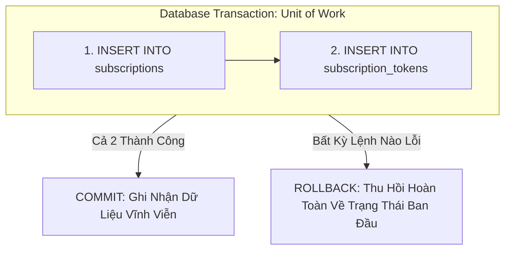
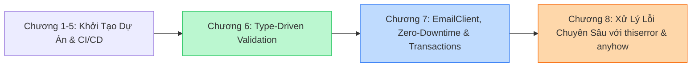

import { Callout } from "fumadocs-ui/components/callout";

Ở bài trước, chúng ta đã kết nối thành công toàn bộ luồng gửi email xác thực và kiểm tra token. Thế nhưng, nếu bạn nhìn kỹ vào request handler `subscribe` hiện tại, một quả bom nổ chậm về tính toàn vẹn dữ liệu vẫn đang âm thầm ẩn nấp!

---

## I. Nguy Cơ Dữ Liệu Mồ Côi: Tất Cả Hoặc Không Gì Cả (All Or Nothing)

Hiện tại, trong hàm `subscribe`, chúng ta đang thực hiện **hai thao tác ghi độc lập** vào cơ sở dữ liệu PostgreSQL:
1. Ghi thông tin độc giả vào bảng `subscriptions`:
   ```rust
   let subscriber_id = insert_subscriber(&pool, &new_subscriber).await?;
   ```
2. Ghi mã token xác thực vào bảng `subscription_tokens`:
   ```rust
   store_token(&pool, subscriber_id, &subscription_token).await?;
   ```

Hãy thử đặt câu hỏi của một Senior Architect: **Điều gì sẽ xảy ra nếu ứng dụng bị crash hoặc kết nối mạng giữa server và database bị đứt quãng ngay giữa hai câu lệnh này?**

```text
[INSERT subscriptions] ────────► Thành công! (Lưu subscriber_id = ABC, status = 'pending')
                                    │
                                    ▼ (MÁY CHỦ SẬP / MẠNG ĐỨT TẠI ĐÂY!)
                                    │
[INSERT subscription_tokens] ───► KHÔNG BAO GIỜ ĐƯỢC THỰC THI!
```

Hậu quả xảy ra trên cơ sở dữ liệu là một thảm họa:
- Độc giả đã được lưu vào database với trạng thái `pending_confirmation`.
- Nhưng trong bảng `subscription_tokens`, **hoàn toàn không có bất kỳ token nào gắn với độc giả này**!
- Bản ghi này trở thành một **bản ghi mồ côi (dangling data / orphan record)**. 
- Người dùng không bao giờ nhận được token hợp lệ để kích hoạt tài khoản. Nếu họ cố gắng vào trang web đăng ký lại, hệ thống sẽ báo lỗi trùng lặp email! Họ bị kẹt trong trạng thái "lấp lửng" vĩnh viễn mà không có cách nào tự giải cứu.

Số lượng câu truy vấn ghi càng nhiều, số lượng trạng thái lỗi rác sinh ra trong database càng phức tạp và không thể kiểm soát.

Giải pháp kinh điển của các hệ quản trị cơ sở dữ liệu quan hệ (RDBMS) cho bài toán này chính là: **Giao dịch (Database Transactions)**.

---

## II. Nguyên Lý Của Database Transactions

Một **Transaction (Giao dịch)** là một cơ chế cho phép chúng ta gom nhóm nhiều câu lệnh thao tác dữ liệu lại với nhau thành **một đơn vị công việc duy nhất (single unit of work)**.

Database cam kết bảo đảm thuộc tính **Nguyên tử (Atomicity)** — chữ **A** trong bộ quy chuẩn **ACID**:
- **All or Nothing**: Toàn bộ các câu lệnh trong transaction phải cùng thành công, hoặc không có câu lệnh nào được phép để lại dấu vết trong database. 
- Database tuyệt đối không bao giờ rơi vào trạng thái dở dang nơi chỉ có một phần các câu lệnh được thực thi.



Nhờ có Transaction, số lượng trạng thái kết thúc có thể xảy ra của cơ sở dữ liệu rút gọn từ 3 trường hợp xuống còn **đúng 2 trường hợp**:
1. Cả độc giả và token đều được lưu trữ hoàn tất.
2. Hoặc không có gì được lưu trữ cả (người dùng có thể an tâm bấm đăng ký lại từ đầu).

---

## III. Transactions Trong PostgreSQL

Trong ngôn ngữ SQL của PostgreSQL, một transaction bắt đầu bằng lệnh [`BEGIN`](https://www.postgresql.org/docs/current/sql-begin.html):

```sql
BEGIN;
    INSERT INTO subscriptions (id, email, name, subscribed_at, status)
    VALUES ('...', '...', '...', NOW(), 'pending_confirmation');

    INSERT INTO subscription_tokens (subscription_token, subscriber_id)
    VALUES ('...', '...');
COMMIT;
```

Tất cả các câu lệnh nằm giữa `BEGIN` và `COMMIT` đều thuộc về cùng một transaction:
- Nếu tất cả câu lệnh đều thành công, lệnh [`COMMIT`](https://www.postgresql.org/docs/current/sql-commit.html) sẽ chính thức lưu các thay đổi vào đĩa cứng và cho phép các kết nối khác nhìn thấy dữ liệu mới.
- Nếu có bất kỳ câu lệnh nào thất bại (hoặc nếu kết nối bị đứt giữa chừng), database sẽ tự động thực hiện thao tác **`ROLLBACK`**: toàn bộ các thay đổi trước đó bị hủy bỏ hoàn toàn, trả database về nguyên trạng như chưa từng có chuyện gì xảy ra. Bạn cũng có thể chủ động kích hoạt thao tác này bằng lệnh [`ROLLBACK`](https://www.postgresql.org/docs/current/sql-rollback.html).

<Callout type="info" title="Tìm Hiểu Thêm Về Mức Độ Cô Lập (Isolation Levels)">
Bên cạnh tính nguyên tử, Transaction còn che giấu các thay đổi chưa được commit trước các câu truy vấn đồng thời khác đang chạy trên cùng các bảng. Tùy theo nhu cầu chịu tải và mức độ khắt khe của nghiệp vụ, bạn có thể thiết lập các mức độ cô lập (Read Committed, Repeatable Read, Serializable). Cuốn sách kinh điển *"Designing Data-Intensive Applications"* của Martin Kleppmann là tài liệu bắt buộc phải đọc nếu bạn muốn làm chủ chủ đề này.
</Callout>

---

## IV. Quản Lý Transactions Trong SQLx

SQLx cung cấp một API tuyệt vời và an toàn tuyệt đối để quản lý database transactions trong Rust.

Chúng ta bắt đầu một transaction bằng cách gọi phương thức `.begin()` trên connection pool:

```rust
//! src/routes/subscriptions.rs
// [...]

pub async fn subscribe(
    form: web::Form<FormData>,
    pool: web::Data<PgPool>,
    email_client: web::Data<EmailClient>,
    base_url: web::Data<ApplicationBaseUrl>,
) -> HttpResponse {
    let new_subscriber = match form.0.try_into() {
        Ok(subscriber) => subscriber,
        Err(_) => return HttpResponse::BadRequest().finish(),
    };
    
    // Khởi tạo transaction mới từ pool
    let mut transaction = match pool.begin().await {
        Ok(transaction) => transaction,
        Err(_) => return HttpResponse::InternalServerError().finish(),
    };

    // [...]
```

Phương thức `pool.begin().await` sẽ mượn một kết nối độc quyền từ pool và gửi lệnh `BEGIN` tới PostgreSQL, trả về một đối tượng kiểu [`sqlx::Transaction`](https://docs.rs/sqlx/0.7.1/sqlx/struct.Transaction.html).

### 1. Truyền Transaction Vào Các Hàm Thực Thi

Đối tượng `Transaction` implement trait `DerefMut<Target = PgConnection>`, do đó một tham chiếu khả biến `&mut Transaction` có thể được truyền trực tiếp vào macro `sqlx::query!` để đóng vai trò là Executor:

Cập nhật lại chữ ký của hàm `insert_subscriber`:

```rust
//! src/routes/subscriptions.rs
use sqlx::{Postgres, Transaction};

#[tracing::instrument(
    name = "Saving new subscriber details in the database",
    skip(new_subscriber, transaction)
)]
pub async fn insert_subscriber(
    transaction: &mut Transaction<'_, Postgres>,
    new_subscriber: &NewSubscriber,
) -> Result<Uuid, sqlx::Error> {
    let subscriber_id = Uuid::new_v4();
    sqlx::query!(
        r#"
        INSERT INTO subscriptions (id, email, name, subscribed_at, status)
        VALUES ($1, $2, $3, $4, 'pending_confirmation')
        "#,
        subscriber_id,
        new_subscriber.email.as_ref(),
        new_subscriber.name.as_ref(),
        Utc::now()
    )
    // Thực thi câu lệnh bên trong transaction!
    .execute(&mut **transaction)
    .await
    .map_err(|e| {
        tracing::error!("Failed to execute query: {:?}", e);
        e
    })?;
    Ok(subscriber_id)
}
```

Cập nhật tương tự cho hàm `store_token`:

```rust
//! src/routes/subscriptions.rs

#[tracing::instrument(
    name = "Store subscription token in the database",
    skip(subscription_token, transaction)
)]
pub async fn store_token(
    transaction: &mut Transaction<'_, Postgres>,
    subscriber_id: Uuid,
    subscription_token: &str,
) -> Result<(), sqlx::Error> {
    sqlx::query!(
        r#"INSERT INTO subscription_tokens (subscription_token, subscriber_id)
        VALUES ($1, $2)"#,
        subscription_token,
        subscriber_id
    )
    .execute(&mut **transaction)
    .await
    .map_err(|e| {
        tracing::error!("Failed to execute query: {:?}", e);
        e
    })?;
    Ok(())
}
```

---

### 2. Cam Kết Giao Dịch Với `.commit()` & Cơ Chế Tự Động Rollback Của Rust

Sau khi cả hai câu lệnh ghi đều thành công, chúng ta gọi `.commit()` để kết thúc transaction:

```rust
//! src/routes/subscriptions.rs
// [...]

pub async fn subscribe(
    form: web::Form<FormData>,
    pool: web::Data<PgPool>,
    email_client: web::Data<EmailClient>,
    base_url: web::Data<ApplicationBaseUrl>,
) -> HttpResponse {
    let new_subscriber = match form.0.try_into() {
        Ok(subscriber) => subscriber,
        Err(_) => return HttpResponse::BadRequest().finish(),
    };
    let mut transaction = match pool.begin().await {
        Ok(transaction) => transaction,
        Err(_) => return HttpResponse::InternalServerError().finish(),
    };
    
    let subscriber_id = match insert_subscriber(&mut transaction, &new_subscriber).await {
        Ok(id) => id,
        Err(_) => return HttpResponse::InternalServerError().finish(),
    };
    
    let subscription_token = generate_subscription_token();
    if store_token(&mut transaction, subscriber_id, &subscription_token)
        .await
        .is_err()
    {
        return HttpResponse::InternalServerError().finish();
    }
    
    // Cam kết ghi dữ liệu vĩnh viễn vào database!
    if transaction.commit().await.is_err() {
        return HttpResponse::InternalServerError().finish();
    }
    
    // Chỉ gửi email khi dữ liệu đã được commit thành công vào database!
    if send_confirmation_email(
        &email_client,
        new_subscriber,
        &base_url.0,
        &subscription_token,
    )
    .await
    .is_err()
    {
        return HttpResponse::InternalServerError().finish();
    }
    
    HttpResponse::Ok().finish()
}
```

<Callout type="info" title="Sự Kỳ Diệu Của Rust Drop Semantics">
Hãy chú ý điều gì xảy ra nếu `store_token` bị lỗi và hàm `subscribe` thoát sớm với `return HttpResponse::InternalServerError()`:
- Biến `transaction` sẽ đi ra ngoài tầm vực (out of scope) và hàm hủy (`Drop`) của nó được kích hoạt tự động.
- Trong hàm `drop` của `sqlx::Transaction`, SQLx nhận thấy transaction này **chưa hề được gọi `.commit()`**, và nó sẽ **tự động gửi lệnh `ROLLBACK` bất đồng bộ ngầm** về phía PostgreSQL!

Bạn không cần phải viết các khối `try/catch/finally` dài dòng để gọi `rollback()` thủ công. Hệ thống Ownership và Drop của Rust bảo đảm 100% không bao giờ có một transaction nào bị treo lơ lửng hay rò rỉ kết nối!
</Callout>

Chạy lại toàn bộ test suite của dự án:

```text
running 8 tests
test health_check_works ... ok
test subscribe_returns_a_400_when_data_is_missing ... ok
test subscribe_returns_a_400_when_fields_are_present_but_invalid ... ok
test subscribe_returns_a_200_for_valid_form_data ... ok
test subscribe_sends_a_confirmation_email_for_valid_data ... ok
test subscribe_sends_a_confirmation_email_with_a_link ... ok
test confirmations_without_token_are_rejected_with_a_400 ... ok
test the_url_link_submitted_by_subscriber_returns_a_200_if_called ... ok

test result: ok. 8 passed; 0 failed; 0 ignored; 0 measured; 0 filtered out
```

**Tất cả 8 integration tests lớn đều đã vượt qua thành công mỹ mãn!**

---

## V. Tổng Kết Toàn Diện Chặng Đường 7 Chương Đầu Tiên

Chúng ta đã vừa hoàn thành một trong những chương đồ sộ và quan trọng nhất của toàn bộ cuốn sách:



### Những Thành Tựu Kỹ Thuật Đã Đạt Được:
1. **Double Opt-In Flow hoàn chỉnh**: Bảo đảm 100% độc giả đăng ký đều có sự đồng thuận rõ ràng theo chuẩn GDPR và hạn chế triệt để vấn nạn thư rác.
2. **REST Client chuyên nghiệp**: Xây dựng `EmailClient` trên nền `reqwest` với Connection Pool tối ưu, tuần tự hóa Zero-allocation và được kiểm thử toàn diện bằng `wiremock`.
3. **Cấu trúc Test Suite bền vững theo quy mô**: Trừu tượng hóa `TestApp`, giải quyết bài toán thời gian biên dịch của Cargo và xây dựng Test API Client trong sáng.
4. **Tư duy vận hành Zero-Downtime**: Hiểu sâu sắc cơ chế hoạt động của Load Balancers, Rolling Update Deployments và quy trình Multi-step Migrations 3 bước để tiến hóa schema database mà không gây gián đoạn hệ thống.
5. **Bảo toàn dữ liệu bằng Database Transactions**: Triệt tiêu hoàn toàn nguy cơ dữ liệu mồ côi bằng `sqlx::Transaction` kết hợp với Rust Drop semantics.

### Vấn Đề Tiếp Theo: Lỗ Hổng Trong Việc Xử Lý Lỗi
Nếu nhìn kỹ lại hàm `subscribe`, bạn sẽ nhận thấy chúng ta đang xử lý lỗi rất thô sơ: hễ có bất kỳ lỗi nào phát sinh (từ database, từ việc gửi email, hay lỗi kết nối), chúng ta đều vội vàng trả về `HttpResponse::InternalServerError().finish()`.

Chúng ta không hề biết lỗi đó thuộc loại nào, không thể trích xuất ngữ cảnh chi tiết để gửi vào telemetry log, và người dùng cũng không nhận được bất kỳ thông tin hữu ích nào.

Làm thế nào để xây dựng một kiến trúc xử lý lỗi thanh lịch, phân tầng rõ ràng giữa lỗi nội bộ và phản hồi bên ngoài với hai crate hàng đầu là **`thiserror`** và **`anyhow`**? Đó chính là chủ đề hấp dẫn đang chờ đón chúng ta trong **Chương 8: Error Handling**!
