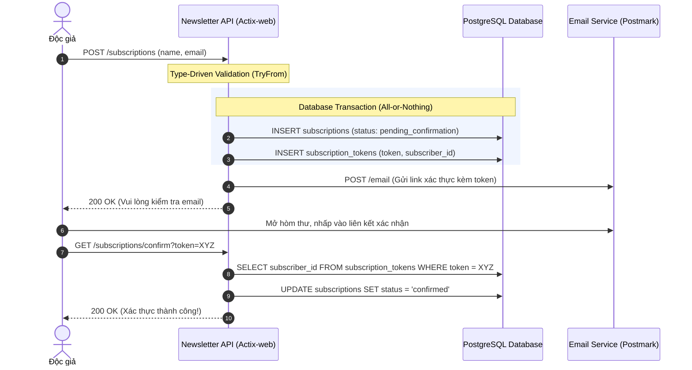

import { Callout } from "fumadocs-ui/components/callout";

# Tổng Quan Chương 7: Reject Invalid Subscribers #2

Ở Chương 6, chúng ta đã bảo vệ vững chắc endpoint `POST /subscriptions` bằng kỹ thuật Type-Driven Development: tên người dùng và địa chỉ email phải thỏa mãn các ràng buộc nghiệp vụ và định dạng cú pháp nghiêm ngặt.

Thế nhưng, một địa chỉ email đúng chuẩn cú pháp (`syntactically valid`) mới chỉ là điều kiện cần chứ chưa phải điều kiện đủ. Chúng ta hoàn toàn không biết liệu hòm thư đó có thực sự tồn tại hay không, và quan trọng hơn cả: **người nhập email vào form có thực sự là chủ nhân của hòm thư đó hay không?**

Nếu không có cơ chế xác minh, bất kỳ ai cũng có thể nhập email của người khác để quấy rối (email bombing), hoặc một chủ sở hữu newsletter vô lương tâm có thể cào hàng loạt email trên mạng rồi tự ý đưa vào danh sách gửi tin.

<Callout type="warn" title="Subscriber Consent">
Một request đến `POST /subscriptions` chưa đủ để khẳng định chủ hộp thư đồng ý nhận newsletter. Chương này dùng confirmation email để xác nhận người đăng ký có thể nhận thư và muốn đăng ký; sách lưu ý explicit consent là yêu cầu pháp lý khi xử lý dữ liệu công dân châu Âu.
</Callout>

---

## I. Bức Tranh Kiến Trúc & Luồng Người Dùng (Confirmation Flow)

Trong chương này, chúng ta sẽ thiết kế và hiện thực một chuỗi tương tác hoàn chỉnh giữa người dùng, Web Server Actix-web, cơ sở dữ liệu PostgreSQL và dịch vụ gửi email bên thứ ba (Postmark):

---

## II. Các Thách Thức Kỹ Thuật Lớn Được Giải Quyết

Để hiện thực hóa quy trình trên đạt chuẩn production, chúng ta sẽ lần lượt vượt qua 5 bài toán kỹ thuật hóc búa:

1. **Xây dựng REST Client an toàn với `reqwest` & `wiremock`**:
   - Tối ưu hiệu năng bằng Connection Pooling (`reqwest::Client`) và chia sẻ an toàn giữa các Actix worker threads với `web::Data`.
   - Giả lập toàn diện HTTP server bên thứ ba bằng crate `wiremock`: kiểm tra Happy Path (Headers, Method, JSON Body) và các kịch bản lỗi biên mạng (Network Timeouts, 500 Internal Error, 400 Bad Request) theo nguyên lý Fail-Fast.
2. **Kỹ thuật tổ chức Test Suite bền vững theo quy mô (Scale)**:
   - Mổ xẻ nguyên lý *"Test code is still code"*.
   - Khắc phục nhược điểm thời gian biên dịch của mô hình *"One test file, one crate"* trong Cargo.
   - Thiết kế abstraction `TestApp` chia sẻ logic khởi tạo server và cung cấp client API chuyên dụng phục vụ kiểm thử.
3. **Triển khai không gián đoạn (Zero-Downtime Deployments)**:
   - Cơ chế hoạt động của Load Balancers, Horizontal Scaling và Health Checks (Active vs Passive).
   - Mô phỏng quá trình Rolling Update Deployments: phiên bản ứng dụng cũ (A) và phiên bản mới (B) chạy song song và cùng phục vụ lưu lượng truy cập thực tế.
4. **Tiến hóa cơ sở dữ liệu an toàn với Multi-step Migrations**:
   - Bản chất của trạng thái lưu trữ bên ngoài ứng dụng (State is kept outside the application).
   - Giải quyết xung đột schema khi phiên bản code cũ và mới cùng chạy đồng thời.
   - Quy trình 3 bước an toàn để thêm một cột bắt buộc (`NOT NULL`) vào bảng đang chứa dữ liệu thực tế mà không gây gián đoạn hệ thống.
5. **Giao dịch cơ sở dữ liệu (Database Transactions) với SQLx**:
   - Nguy cơ dữ liệu mồ côi (dangling data/orphan records) khi thực hiện nhiều thao tác ghi liên tiếp.
   - Nguyên lý nguyên tử (Atomicity): All or Nothing.
   - Sử dụng `sqlx::Transaction` để bảo đảm tính toàn vẹn dữ liệu tuyệt đối giữa bảng `subscriptions` và `subscription_tokens`.

---

## III. Cấu Trúc Các Bài Học Trong Chương 7

Chương 7 là chương dài và đồ sộ nhất trong nửa đầu cuốn sách, được phân tách thành 5 bài học chuyên sâu:

| Bài học | Nội dung chính |
| :--- | :--- |
| **[7.1 Xác Thực Email & Thiết Kế EmailClient](./01-xac-thuc-email-va-thiet-ke-emailclient)** | Luồng người dùng, sự đồng thuận của subscriber, xây dựng `EmailClient` bằng `reqwest`, connection pool và kỹ thuật HTTP mocking toàn diện với `wiremock`. |
| **[7.2 Nguyên Tắc Viết Test Suite Bền Vững](./02-nguyen-tac-viet-test-suite-ben-vung)** | Tại sao viết test và tại sao ngại viết test, cấu trúc test crate trong Cargo, chia sẻ helpers và startup logic với struct `TestApp`, xây dựng test API client. |
| **[7.3 Zero-Downtime & Database Migrations](./03-zero-downtime-va-database-migrations)** | Triển khai không gián đoạn với Rolling Updates & Load Balancers, rủi ro tương thích schema, kỹ thuật Multi-step Migrations 3 bước thêm cột bắt buộc an toàn. |
| **[7.4 Gửi Email Xác Thực & Tokens](./04-gui-email-xac-thuc-va-tokens)** | Gửi email động qua Postmark, trạng thái Pending Confirmation, sườn endpoint `GET /subscriptions/confirm`, sinh token an toàn ngẫu nhiên với `rand`. |
| **[7.5 Database Transactions Trong Postgres & SQLx](./05-database-transactions-trong-postgres-sqlx)** | Nguyên lý All-or-nothing, Transactions trong PostgreSQL (`BEGIN`, `COMMIT`, `ROLLBACK`), quản lý `sqlx::Transaction` và tổng kết toàn bộ chặng đường 7 chương. |
