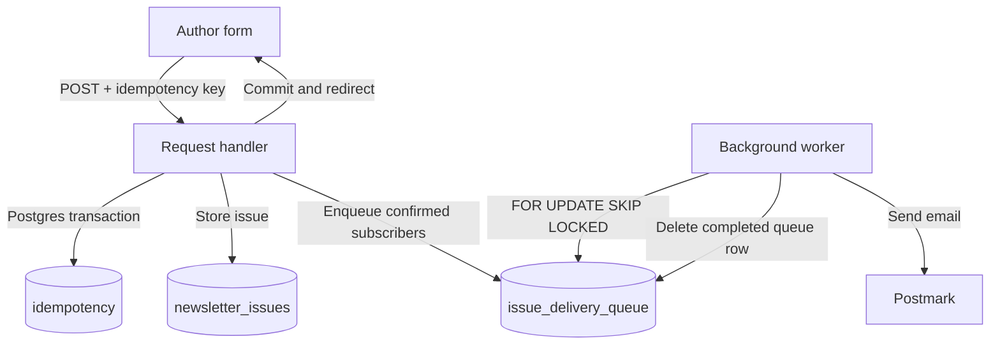

import { Callout } from "fumadocs-ui/components/callout";

# Tổng Quan Chương 11: Luồng Chịu Lỗi & Idempotency

Ban đầu endpoint newsletter truy vấn subscriber rồi gửi email tuần tự qua Postmark. Cách làm đơn giản này gặp vấn đề khi có lỗi giữa chừng, ứng dụng crash hoặc người dùng gửi lại form. Chương khảo sát cách giảm gửi trùng và tiếp tục workflow khi có lỗi; không đảm bảo email không bao giờ bị mất hay trùng.

## Lộ trình

- [11.1–11.3: Endpoint và failure modes](/docs/chuong-11-fault-tolerant-workflows/01-post-admin-newsletters-va-cac-failure-modes) — Luồng hiện tại, mục tiêu best-effort delivery, lỗi input/Postgres/Postmark, crash và thao tác người dùng.
- [11.4–11.6: Idempotency và keys](/docs/chuong-11-fault-tolerant-workflows/02-khai-niem-idempotency-va-chia-khoa) — Định nghĩa theo khả năng quan sát, ví dụ thanh toán, request đồng thời và chiến lược stateful/stateless. Postmark không hỗ trợ idempotency nên sách chọn save-and-replay.
- [11.7–11.8: Store và save-and-replay](/docs/chuong-11-fault-tolerant-workflows/03-idempotency-store-save-and-replay) — Lưu response trong Postgres, composite type cho HTTP headers và serialize body response.
- [11.9–11.11: Đồng bộ, phục hồi và epilogue](/docs/chuong-11-fault-tolerant-workflows/04-concurrent-requests-va-recovery) — Reservation bằng transaction và `ON CONFLICT`, giới hạn khi gọi dịch vụ ngoài, active forward recovery với `newsletter_issues`, `issue_delivery_queue` và worker `FOR UPDATE SKIP LOCKED`.

## Luồng ở giai đoạn bất đồng bộ

<Callout type="warn" title="Giới hạn cần nhớ">
Transaction của request bảo vệ các thay đổi Postgres — issue, queue và idempotency response — cùng nhau. Nó không bao trùm API Postmark. Trong ví dụ worker của sách, lỗi gửi được log nhưng task vẫn bị xóa; retry với `n_retries`, `execute_after` và backoff chỉ được đề xuất làm bài tập, chưa được triển khai. Idempotency key cũng chưa có cơ chế hết hạn.
</Callout>
