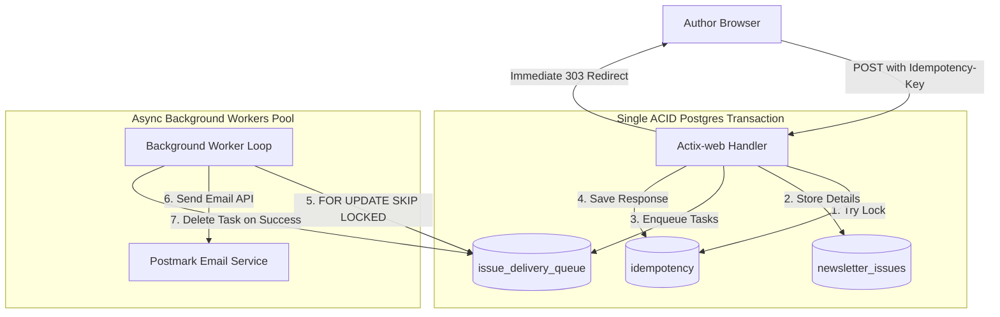

import { Callout } from "fumadocs-ui/components/callout";

# Tổng Quan Chương 11: Luồng Chịu Lỗi & Tính Bất Biến (Idempotency)

Ở các chương trước, endpoint gửi bản tin được thiết kế một cách ngây thơ: khi tác giả nhấn xuất bản, ứng dụng lập tức duyệt qua danh sách độc giả và gửi từng email một qua mạng. Cách làm này có thể chấp nhận được nếu danh sách chỉ có vài chục người, nhưng **chắc chắn sẽ sụp đổ thảm hại** khi quy mô lên tới hàng ngàn độc giả trong môi trường phân tán thực tế.

Chương 11 là chương đỉnh cao khép lại hành trình kiến trúc của cuốn sách, đưa ứng dụng của chúng ta chạm tới chuẩn mực **Chịu lỗi toàn diện (Fault-tolerant Architecture)**. Chúng ta sẽ giải quyết bài toán hóc búa nhất của hệ thống phân tán: *Làm thế nào để hệ thống vẫn vận hành chính xác, không mất mát dữ liệu và không gửi thư trùng lặp, ngay cả khi xảy ra sự cố mạng, ứng dụng bị crash đột ngột hay người dùng liên tục nhấn F5/Retry?*

---

## I. Lộ Trình Nội Dung Chương 11

Chương này gồm 4 bài học chuyên sâu về kiến trúc hệ thống:

- **[11.1 - 11.3: Ôn Lại POST /admin/newsletters & Các Loại Lỗi Hệ Thống](/docs/chuong-11-fault-tolerant-workflows/01-post-admin-newsletters-va-cac-failure-modes)**:
  Phân tích kiến trúc hiện tại của `POST /admin/newsletters`. Định nghĩa mục tiêu *"Best-effort delivery"*. Mổ xẻ 4 kịch bản lỗi chí mạng: dữ liệu đầu vào không hợp lệ, sự cố mạng I/O (Postgres & Postmark), ứng dụng bị ngắt nguồn đột ngột (crash), và hành vi người dùng bấm đúp hoặc hết thời gian chờ (timeout).

- **[11.4 - 11.6: Khái Niệm Idempotency, Idempotency Keys & Chiến Lược](/docs/chuong-11-fault-tolerant-workflows/02-khai-niem-idempotency-va-chia-khoa)**:
  Bản chất toán học và thực tế của tính bất biến (Idempotency / Retry-safety). Bài học kinh điển từ hệ thống cổng thanh toán quốc tế (Stripe/PayPal). Cơ chế hoạt động của **Idempotency Keys**. So sánh hai trường phái: *Stateful Idempotency (Save-and-Replay)* và *Stateless Idempotency (Deterministic Key Generation)*.

- **[11.7 - 11.8: Lưu Trữ Trạng Thái: Idempotency Store & Mô Hình Save-and-Replay](/docs/chuong-11-fault-tolerant-workflows/03-idempotency-store-save-and-replay)**:
  Lựa chọn cơ sở dữ liệu tối ưu giữa Redis và PostgreSQL. Thiết kế bảng `idempotency` và giải quyết bài toán mảng tuple trong Postgres bằng Composite Type `header_pair`. Xây dựng kiểu dữ liệu miền `IdempotencyKey` và triển khai cơ chế tuần tự hóa/giải tuần tự hóa toàn bộ HTTP Response.

- **[11.9 - 11.11: Xử Lý Request Đồng Thời, Forward Recovery & Lời Kết](/docs/chuong-11-fault-tolerant-workflows/04-concurrent-requests-va-recovery)**:
  Đồng bộ hóa các request đồng thời bằng Row-level Lock trong Postgres (`ON CONFLICT DO NOTHING`). Giải quyết bế tắc giao dịch phân tán (Distributed Transactions): Backward Recovery vs Forward Recovery. Hiện thực hóa kiến trúc xử lý bất đồng bộ (**Transactional Outbox Pattern**) với bảng `newsletter_issues`, hàng đợi `issue_delivery_queue`, Background Worker sử dụng `FOR UPDATE SKIP LOCKED`, và lời kết đầy cảm hứng của cuốn sách.

---

## II. Sơ Đồ Kiến Trúc Chịu Lỗi Hoàn Chỉnh

<Callout type="info" title="Tinh hoa của Kiến trúc Transactional Outbox">
Bằng cách chuyển đổi từ việc gửi email trực tiếp sang đưa các tác vụ vào bảng hàng đợi nội bộ trong PostgreSQL, **toàn bộ thao tác của request handler được đóng gói gọn trong một giao dịch ACID duy nhất**. Hoặc toàn bộ việc ghi nhận bản tin, xếp hàng email và lưu idempotency cùng thành công, hoặc không có bất kỳ thứ gì thay đổi — triệt tiêu 100% tình trạng dữ liệu dở dang!
</Callout>
